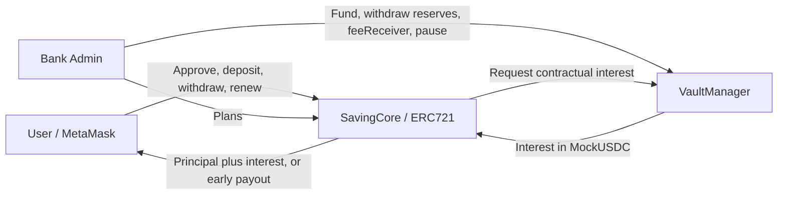

# Online Banking System

Ứng dụng tiền gửi có kỳ hạn bằng MockUSDC trên Ethereum: người dùng mở deposit để nhận chứng chỉ ERC721, theo dõi portfolio, rút trước hạn/đáo hạn và tái tục. Bank Admin quản lý plan, quỹ lãi, feeReceiver và pause; **không có quyền sửa principal, APR snapshot, penalty snapshot, startAt hay maturityAt của deposit đã mở**.

[](https://www.youtube.com/watch?v=vs1NHUmvU0I)


## Personal Variant

| Tham số | Công thức theo Student ID | Giá trị của dự án |
| --- | --- | --- |
| Hai chữ số cuối | Suffix đã xác định | **10** |
| A, B | A là chữ số cuối; B là chữ số liền trước | **A = 0, B = 1** |
| Grace period | `(A % 3) + 2` ngày | **2 ngày = 172.800 giây** |
| Default APR | `200 + A * 25` bps | **200 bps = 2,00%/năm** |
| Early penalty | `300 + B * 50` bps | **350 bps = 3,50%** |
| Default tenor | B chẵn: 90 ngày; B lẻ: 180 ngày | **180 ngày = 15.552.000 giây** |

Nguồn cấu hình: [personal-variant.ts](config/personal-variant.ts). [Deploy](scripts/deploy.ts) truyền grace vào constructor; [seed](scripts/seed.ts) tạo plan #1 từ cấu hình; [contract tests](test/SavingCore.ts) và [duration tests](test/SavingCoreDuration.ts) xác nhận các giá trị thực tế. Plan ngắn là khả năng bổ sung để thử nghiệm; không thay plan mặc định hay rút ngắn grace.

## Kiến trúc và nguyên tắc tiền



- [MockUSDC](contracts/MockUSDC.sol): ERC20 6 decimals, mint permissionless cho thử nghiệm; không phải USDC có giá trị thật.
- [SavingCore](contracts/SavingCore.sol): giữ principal, quản lý plan/deposit và NFT certificate. `totalPrincipal` chỉ tính principal của deposit Active, không tính token được donate trực tiếp.
- [VaultManager](contracts/VaultManager.sol): giữ reserve của ngân hàng để trả lãi. Chỉ Core được gọi `payInterest`; lãi đi Vault → Core → user hoặc được cộng vào principal mới khi renew.
- Admin là `VaultManager.owner()`, được Core đọc động. Chuyển ownership của Vault đồng thời đổi quyền quản trị plan; không đổi owner của NFT user.
- [Frontend](frontend/README.md): React 18, TypeScript, Vite, ethers v6, MetaMask/EIP-1193. Portfolio tìm chứng chỉ theo `ownerOf`, không theo người gửi ban đầu.

NFT không bị burn sau settlement. Status: `0 Active`, `1 Withdrawn`, `2 ManualRenewed`, `3 AutoRenewed`. Chứng chỉ terminal vẫn có thể chuyển như ERC721 nhưng không tạo quyền nhận tiền lần nữa.

## Quy tắc nghiệp vụ

Đặt `P` là principal tính bằng token units, `T = maturityAt - startAt`, `M = maturityAt`, `G = M + gracePeriodSeconds`.

```text
1 USDC = 1_000_000 token units
Interest = floor(P × aprBpsAtOpen × T / (10_000 × 365 × 86_400))
Penalty  = floor(P × penaltyBpsAtOpen / 10_000)
Early payout = P - Penalty; interest = 0
Maturity payout / renewal principal = P + Interest
```

`Math.mulDiv` thực hiện nhân/chia và làm tròn xuống. Với 1.000 USDC, APR 200 bps, 180 ngày: lãi **9,863013 USDC**, payout **1.009,863013 USDC**; rút sớm nhận **965 USDC**, feeReceiver nhận **35 USDC**.

APR và penalty được snapshot khi mở deposit. Plan update chỉ ảnh hưởng deposit mới hoặc target plan của manual renewal. Không có setter cho deposit terms; API `setDepositTimeline` cũ cùng UI/script sửa timeline đã được loại bỏ. Pause chặn mở deposit, settlement và renewal; view, NFT transfer và một số thao tác quản trị như fund/plan vẫn hoạt động theo contract.

## Yêu cầu và cài đặt

- Node **24.20.0** theo `.node-version`; npm **>=11**, `packageManager` khai báo npm 11.21.0.
- PowerShell/Windows dùng `npm.cmd`, `npx.cmd`; hệ khác dùng `npm`, `npx`.
- Chạy từ root repository. Dùng hai lockfiles để tái lập dependencies; mạng cần thiết cho lần tải compiler/dependencies/Chromium đầu tiên.

```powershell
npm.cmd ci
npm.cmd --prefix frontend ci
npm.cmd run compile
npm.cmd run typecheck
npm.cmd --prefix frontend run typecheck
npm.cmd run typecheck:e2e
```

Compile tạo artifacts và types. Sau `npm.cmd run clean`, compile lại trước typecheck. `Counter` chỉ còn là sample toolchain, không phải business contract chính.

## Khởi động nhanh để demo

```powershell
npm.cmd run demo:local
```

Giữ terminal mở; truy cập **http://127.0.0.1:5174**. Lệnh tự deploy, seed và verify trên node riêng **http://127.0.0.1:18545**, chain ID **31337**. Kết nối MetaMask vào endpoint đó; Ctrl+C dừng stack. Mỗi lần khởi động là một chain mới, dữ liệu runtime nằm trong `.e2e/runtime/` và không ghi đè deployment hiện hành.

| Vai trò trong demo | Hardhat account | Địa chỉ |
| --- | --- | --- |
| Deployer | #0 | `0xf39Fd6e51aad88F6F4ce6aB8827279cffFb92266` |
| Bank Admin | #1 | `0x70997970C51812dc3A010C7d01b50e0d17dc79C8` |
| Alice | #2 | `0x3C44CdDdB6a900fa2b585dd299e03d12FA4293BC` |
| Bob | #3 | `0x90F79bf6EB2c4f870365E785982E1f101E93b906` |
| Fee receiver | #4 | `0x15d34AAf54267DB7D7c367839AAf71A00a2C6A65` |

Seed có plan #1 Personal Variant, plan #2 360 ngày/APR 500 bps, plan #3 disabled; vault 5.000 USDC; Alice được mint 10.000 và mở sẵn deposit #1 trị giá 1.000, còn 9.000 USDC. Chi tiết import các account local và checklist user/admin: [D5-02](document/D5-02.md#6-checklist-demo-metamask-useradmin).

User chọn plan → nhập principal → Approve nếu thiếu allowance → Open Deposit → xem receipt/NFT/My Portfolio. Sau một action thành công, balance/portfolio được tải lại; dùng Refresh Portfolio sau thay đổi thời gian hoặc giao dịch từ tài khoản khác. Admin vào Admin Portal để tạo/cập nhật/enable/disable plan, mint token test, fund/withdraw Vault, đổi feeReceiver và pause/unpause.

### Plan ngắn trên local và Sepolia

Admin chọn **New saving plan → Duration unit → Seconds/Minutes/Days**, nhập thời lượng nguyên dương; ví dụ **5 seconds**, APR 2%, penalty 3,5%. Thời lượng tính từ timestamp của giao dịch mở deposit, không phải thời điểm tạo plan. Plan 5 giây với 1.000 USDC sinh **3 token units = 0,000003 USDC**; UI lãi/payout của deposit ngắn hiển thị 6 chữ số thập phân. APR vẫn tính theo năm, không tăng lãi để phục vụ demo.

`createPlan(tenorDays, ...)` giữ API theo ngày; `createPlanSeconds(tenorSeconds, ...)` cho phép kỳ hạn từ 1 giây. Cả hai có cùng giới hạn duration tối đa `uint32.max × 86.400` giây, APR/penalty 0–10.000 bps, min/max 0 nghĩa là không giới hạn. **`planDurationSeconds(planId)` là nguồn thời lượng chính xác**; `getPlan().tenorDays` và `PlanCreated.tenorDays` là phần nguyên ngày để tương thích, có thể bằng 0 với plan dưới một ngày. Event `PlanDurationSet` ghi đúng số giây và chỉ phát khi tạo plan.

Sepolia phải chờ block thật; 5 giây không bảo đảm UI có thể rút đúng sau 5 giây đồng hồ và thường quá ngắn để demo rút sớm. Có thể chọn 60–120 giây để thao tác ví thuận tiện hơn. Grace vẫn **2 ngày**, nên auto-renew không khả dụng ngay sau một deposit 5 giây.

Trên node demo local, có thể tăng thời gian blockchain mà không sửa deposit:

```powershell
# Thay bằng ID thực tế đang Active
npm.cmd run demo:time -- --deposit 2
npm.cmd run demo:time -- --grace 3
```

Script chỉ hỗ trợ node riêng 18545/chain 31337. Sau đó bấm Refresh Portfolio. Tiện ích này không dùng trên Sepolia.

## Deployment thủ công và Sepolia

### Local persistent tại 8545

Terminal thứ nhất chạy `npm.cmd run node`. Terminal thứ hai:

```powershell
$env:SKIP_LOAD_ENV = 'true'
npm.cmd run deploy:localhost
npm.cmd run seed:localhost
npm.cmd run verify-deploy:localhost
npm.cmd run frontend:dev
```

UI mặc định tại 5173, RPC 8545, chain 31337. `hardhatMainnet` là chain mô phỏng tạm thời: `deploy:local` không triển khai vào node 8545 và trạng thái không tồn tại cho lần chạy script khác. Để frontend dùng persistent deployment, chọn các lệnh `*:localhost`.

### Sepolia

Sao chép `.env.example` thành `.env`, thay RPC và private key mẫu bằng ví Sepolia có test ETH. `.env` được Git bỏ qua. Nếu đặt `BANK_ADMIN_ADDRESS`, địa chỉ cần có signer phù hợp để script có thể binding và seed; khi chỉ có một signer Sepolia, mặc định admin/feeReceiver/demo user đều là signer đó.

```powershell
npm.cmd run deploy:sepolia
npm.cmd run seed:sepolia
npm.cmd run verify-deploy:sepolia
npm.cmd run frontend:dev
```

Deploy/seed tự xuất ABI và registry sang `exports/contracts/` và `frontend/src/contracts/`; manifest ở `deployments/<network>.json`. `export-contracts` dùng các manifests có sẵn, không phải một lệnh verify source code trên Etherscan. `verify-deploy:*` kiểm tra bytecode, bindings và cấu hình on-chain.

**Chuyển từ contract cũ có timeline override:** mã của contract đã deploy không đổi khi sửa source. Script deploy mới từ chối resume Core cũ; cần deploy **VaultManager và SavingCore mới**, do Vault chỉ binding Core một lần. Lưu manifest/address cũ trước khi force deploy:

```powershell
# Nếu đã có deployment Sepolia
Copy-Item deployments/sepolia.json deployments/sepolia.previous.json
npm.cmd run deploy:sepolia:force
npm.cmd run seed:sepolia
npm.cmd run verify-deploy:sepolia
```

Force deploy giữ MockUSDC còn bytecode và tạo Vault/Core mới; không tự migrate deposit/NFT/funds cũ. Deposit cũ tiếp tục tồn tại trên địa chỉ cũ với quyền cũ; UI registry mới chỉ trỏ tới deployment mới. Local có lệnh tương ứng `deploy:localhost:force`. Đã redeploy công khai lên Sepolia ngày 29/10/2026, seed 3 plan và fund Vault mới 5.000 MockUSDC; xem [bằng chứng deployment](document/evidence/sepolia-redeploy-2026-10-29.json). Core mới: `0x69371d5829aEb695BC4b12Bd9243AF8584eb0681`; Vault mới: `0xE3D2f34cAe33D694e649c5975A4875E026bdf4c2`.

| Biến | Công dụng và mặc định |
| --- | --- |
| `SEPOLIA_RPC_URL`, `SEPOLIA_PRIVATE_KEY` | Kết nối và ký giao dịch Sepolia; phải cấu hình giá trị thực |
| `BANK_ADMIN_ADDRESS` | Deploy: signer #1 nếu có, nếu không là deployer |
| `FEE_RECEIVER_ADDRESS` | Deploy: signer #2 nếu có, nếu không là deployer; demo tự đặt #4 |
| `DEMO_USER_ADDRESS` | Seed: signer #2 nếu có, nếu không là deployer |
| `LOCAL_RPC_URL`, `VITE_LOCAL_RPC_URL` | RPC local cho Hardhat/frontend; mặc định 8545; demo dùng 18545 |
| `BANKING_ARTIFACT_ROOT` | Output root riêng cho manifests/ABI/registry; mặc định root repository |
| `SKIP_LOAD_ENV` | `true` để không nạp `.env`; demo/E2E tự cấu hình |
| `FORCE_REDEPLOY` | `true` để thay deployment; các npm alias `*:force` đã đặt biến này |

## Tests và coverage

```powershell
npm.cmd run compile
npm.cmd run typecheck
npm.cmd run typecheck:e2e
npm.cmd --prefix frontend test
npm.cmd --prefix frontend run build
npx.cmd playwright install chromium
npm.cmd run test:e2e
npm.cmd run test:e2e:report
```

Để contract tests/coverage không cập nhật manifests/registry đang dùng, chạy trong output root riêng:

```powershell
$previousRoot = $env:BANKING_ARTIFACT_ROOT
$previousSkip = $env:SKIP_LOAD_ENV
try {
  $env:BANKING_ARTIFACT_ROOT = '.e2e/regression'
  $env:SKIP_LOAD_ENV = 'true'
  npm.cmd test
  npm.cmd run coverage
} finally {
  $env:BANKING_ARTIFACT_ROOT = $previousRoot
  $env:SKIP_LOAD_ENV = $previousSkip
}
```

Kết quả xác minh ngày **29/10/2026**: **535 contract tests**, **76 frontend tests**, **10 browser E2E** đạt; typecheck/build thành công. Coverage line/statement: MockUSDC **100%/100%**, VaultManager **100%/100%**, SavingCore **98,69%/98,70%**. Coverage tổng kể cả các contract hỗ trợ test: **96,21%/94,13%**. Báo cáo mới tại `coverage/html/`, `coverage/lcov.info`, `.e2e/report/` và `.e2e/results/`; số liệu chi tiết trong [D5-03](document/D5-03.md).

E2E dùng provider EIP-1193 thử nghiệm chuyển giao dịch thật xuống Hardhat, không điều khiển popup MetaMask thật. Suite bao gồm tạo plan 5 giây từ UI admin và rút đúng P + 3 token units. Báo cáo [D5-02](document/D5-02.md) là bằng chứng lịch sử trước thay đổi duration; không dùng hash/source SHA lịch sử đó để đại diện cho build mới.

## Design Answers

### 1. Transferable certificate — Alice chuyển NFT cho Bob thì ai được rút?

Bob được rút vì quyền tài chính thuộc **owner hiện tại**, không phải người gửi ban đầu; đoạn quyết định là `if (ownerOf(depositId) != msg.sender)` tại [SavingCore.sol dòng 339](contracts/SavingCore.sol#L339), tương tự với early withdrawal và manual renewal. Approved operator có thể chuyển NFT nhưng không trực tiếp settlement khi chưa là owner; auto-renew permissionless luôn mint successor về current owner. Thiết kế giúp chuyển nhượng quyền nhận tiền nhưng việc chuyển nhầm NFT cũng chuyển quyền rút, nên người dùng phải hiểu giá trị của certificate. Bằng chứng: `OWN-002`, `OWN-007` trong [hardening tests](test/SavingCoreHardening.ts) và browser `U06`.

### 2. Empty vault — Vault thiếu tiền trả lãi thì sao?

Hiện dự án chọn quy tắc của đề: `withdrawAtMaturity` gọi `vaultManager.payInterest(interest)` trước payout và toàn bộ giao dịch revert nếu thiếu thanh khoản, kể cả phần principal chưa được trả. Dù principal nằm riêng trong Core, user vẫn có thể bị chặn settlement đến khi ngân hàng fund đủ; status và `totalPrincipal` được rollback cùng giao dịch. Có thể cải tiến bằng principal-only withdrawal kèm interest debt hoặc hàng đợi, nhưng các cơ chế đó chưa được triển khai. `withdrawVault` cũng chưa reserve các khoản lãi đã hứa; đây không phải solvency guard C2. Bằng chứng: `WD-M13` trong [SavingCore tests](test/SavingCore.ts) và [Vault payInterest](contracts/VaultManager.sol#L115).

### 3. Dead bot — Bot offline một tháng thì điều gì xảy ra?

Contract không tự chạy theo thời gian: deposit vẫn Active cho đến một giao dịch hợp lệ và user vẫn có thể maturity withdraw hoặc manual renew nếu chưa bị xử lý. Ai cũng có thể gọi auto-renew sau grace; lần gọi trễ chỉ cộng **lãi của kỳ cũ**, tạo **một** successor với `startAt` là thời điểm thực thi, không backdate hay trả lãi cho tháng chờ. Vì vậy không mất principal/lãi kỳ cũ theo logic contract, nhưng user bỏ lỡ cơ hội sinh lãi trong thời gian idle. Đề xuất keeper dự phòng và thông báo cho user; hiện UI đã có nút trigger nhưng chưa có scheduler production. Bằng chứng: `BND-R08` và `INT-A03` trong [renewal integration tests](test/SavingCoreRenewalIntegration.ts#L219); [trigger-auto-renew.ts](scripts/trigger-auto-renew.ts) là utility một lần, không tự đăng ký lịch và mặc định tạo fixture local khi không có đầu vào.

### 4. Rounding dust — Ai giữ phần dư và có gây sai số dư không?

Lãi dùng `Math.mulDiv` làm tròn xuống tại [SavingCore.sol](contracts/SavingCore.sol#L561), nên user nhận số token units nguyên và phần lãi phân số không được trả, có lợi cho vault. Đây là phần chênh so với phép tính hữu tỉ, không phải một số dư token phân số được tạo ra on-chain; tiền nguyên còn lại vẫn ở vault. Ví dụ 1.000 USDC, 2% APR, 180 ngày có lãi lý thuyết 9.863.013,6986… units nhưng chỉ chuyển 9.863.013, và `PREC-003` xác nhận vault giảm đúng số nguyên đó trong [precision tests](test/SavingCoreEdgeSecurityPrecision.ts#L147). Floor không tự gây underflow hoặc ghi sai số dư; principal cực nhỏ có thể có lãi bằng 0, còn thiếu thanh khoản hoặc vượt giới hạn số học là các điều kiện revert riêng. Với kỳ 5 giây, test `DUR-007` xác nhận lãi 3 units thay vì làm tròn UI thành không có lãi.

### 5. Boundary times — Tại maturity và grace end thì hành vi thế nào?

Tại đúng `M`, đây là maturity settlement: early withdrawal bị chặn bởi `block.timestamp >= deposit.maturityAt`, còn maturity withdrawal/manual renewal chỉ chặn khi `block.timestamp < ...maturityAt`; xem [early](contracts/SavingCore.sol#L381) và [manual](contracts/SavingCore.sol#L430). Auto-renew chỉ chặn khi `block.timestamp < graceEnd`, nên **tại đúng G đã gọi được**, không phải đợi `t > G`. Manual renewal không có upper cutoff tại G: tại và sau G, owner vẫn có thể manual renew hoặc maturity withdraw nếu deposit còn Active; giao dịch hợp lệ thực thi trước sẽ chuyển status, chặn xử lý trùng. Bằng chứng: `BND-R02`, `BND-R04`, `BND-R06` trong [boundary tests](test/SavingCoreRenewalIntegration.ts#L132).

### 6. Disabled plan — Deposit cũ còn làm gì và renew vào plan disabled được không?

Disable plan ngăn mở deposit mới và ngăn chọn nó làm target của manual renewal, nhưng không sửa các snapshot đã mở. User vẫn được early withdraw trước M, maturity withdraw từ M, hoặc manual renew sang một plan enabled khác nếu P + I thỏa min/max của target. Auto-renew vẫn được phép sau G kể cả plan cũ disabled, vì nó giữ tenor/APR/penalty của certificate chứ không áp dụng điều khoản plan hiện tại. Quy tắc này bảo vệ quyền của deposit cũ đồng thời để ngân hàng dừng nhận các khoản gửi mới vào sản phẩm đã đóng. Bằng chứng: [MR-018/MR-019](test/SavingCoreRenewal.ts#L201) và `AR-025` trong [auto-renew tests](test/SavingCoreAutoRenewal.ts).

### 7. Attack thinking — Cơ chế nào chặn một cuộc tấn công thực tế?

Một ERC721 receiver có thể dùng callback khi mint certificate để gọi lồng `openDeposit`/renew/withdraw và cố xử lý tài chính hai lần. Các entrypoint tài chính có `nonReentrant`; settlement kiểm tra Active, ghi trạng thái terminal và cập nhật liability trước external transfers theo checks-effects-interactions, ví dụ [withdrawAtMaturity](contracts/SavingCore.sol#L329). Nếu external call thất bại, EVM rollback toàn bộ thay đổi; nếu người dùng gọi lại sau một settlement thành công, `DepositNotActive` chặn payout lần hai. [REENT-001…005](test/SavingCoreHardening.ts#L520) dùng callback tấn công thật, và `WD-M12` kiểm tra double withdrawal. Thêm nữa, [IMM-001/IMM-002](test/SavingCoreDuration.ts#L135) xác nhận selector sửa timeline đã bị xóa và các thao tác admin còn lại không sửa terms của deposit đang Active.

## Cấu trúc và tài liệu

```text
contracts/              MockUSDC, VaultManager, SavingCore và helpers cho tests
config/                 Personal Variant
scripts/                Deploy, seed, verify, export, trigger; demo/E2E helpers
test/                   Contract regression, boundary, precision và security
frontend/               React UI user/admin và Vitest tests
e2e/                    Browser tests và provider EIP-1193 local
deployments/            Manifests public, không chứa private key
exports/contracts/      ABI và registry xuất cho client
document/               Đề bài, báo cáo task và bằng chứng
```

Nguồn yêu cầu: [Final Assignment](document/Final_Assignment.docx). Báo cáo hiện tại: [D5-03](document/D5-03.md); báo cáo lịch sử demo/E2E: [D5-02](document/D5-02.md). Video và submission thuộc D5-04, không được ghi nhận là đã thực hiện trong task tài liệu này.

## Xử lý lỗi thường gặp

- Dùng `npm.cmd` nếu PowerShell chặn `npm.ps1`; đứng đúng root có `hardhat.config.ts`.
- `LEGACY_CORE_REQUIRES_REDEPLOY`: lưu địa chỉ/manifest cũ rồi dùng alias `deploy:*:force`; không thể sửa bytecode tại địa chỉ cũ.
- Sai network/ABI hoặc không có bytecode: deploy/seed/verify đúng network, tải lại frontend và chọn đúng RPC trong MetaMask.
- Sau khi reset local node, MetaMask có thể giữ nonce cũ: clear activity/nonce của account local rồi kết nối lại.
- Thiếu allowance cần approve; thiếu lãi trong vault cần admin fund; pause cần admin unpause. Không sửa deposit timestamps để vượt các điều kiện này.
- Demo/E2E báo cổng 18545/5174 bận: dừng stack trước đó; harness không dùng lại dịch vụ có sẵn.
- Build hiện có cảnh báo chunk lớn hơn 500 kB nhưng build thành công; console RPC timeout trong test portfolio là lỗi giả lập có chủ đích để kiểm chứng fallback.
