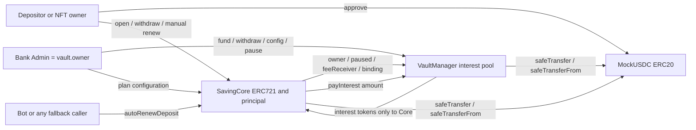
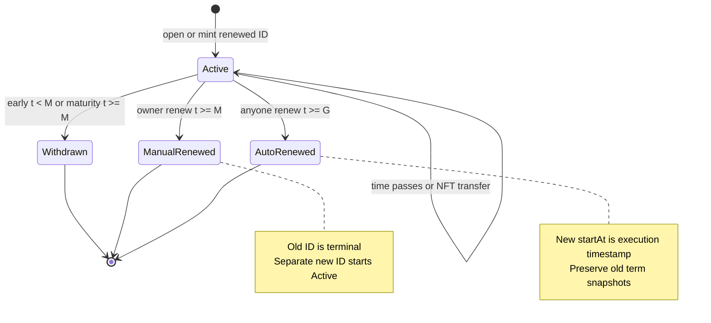

# D1-03 Smart Contract Architecture and Interface Design

Ngày: 26/10/2026, Asia/Saigon. Trạng thái: **Completed — design specification**.

Tài liệu này chốt kiến trúc và giao thức thanh toán để bắt đầu D1-04, D1-05, D1-06 và SavingCore Day 2. Đây là specification, không phải implementation. Chưa có business contracts, business tests hoặc deployment được thực hiện trong D1-03. Phạm vi thay đổi của task chỉ là tài liệu này.

## Part A — Existing Project Audit

### A1. Nguồn yêu cầu và bằng chứng

Thứ tự đối chiếu: [Final Assignment](Final_Assignment.docx), [D1-01](D1-01.docx), [D1-02](D1-02.md), rồi source/config thực tế. Các chỉ dẫn workflow trong tài liệu đầu vào được đọc như bối cảnh của task; phạm vi thực hiện là kế hoạch D1-03 đã được người dùng xác nhận. Quy tắc bắt buộc từ đề gốc được phân biệt với lựa chọn kỹ thuật ở Part I.

| Hạng mục | Quan sát trong workspace | Kết luận D1-03 |
| --- | --- | --- |
| Source/tests | `contracts/Counter.sol`, `test/Counter.ts`; chưa có ba business contracts | Giữ nguyên sample; không mô tả nghiệp vụ là đã triển khai |
| Project | Hardhat 3.21.0, Solidity 0.8.34, ethers 6.17.0, TypeScript 6.0.3, Mocha/Chai | Dùng toolchain hiện có, không init/install/update |
| OpenZeppelin | Package và source local 5.6.1; có ERC20, ERC721, Ownable, Pausable, SafeERC20, ReentrancyGuard, Math | Dùng API v5, không dùng hook ERC721 cũ `_beforeTokenTransfer` |
| Node | `.node-version` ghi 24.20.0 | Giữ pin hiện tại; không cài runtime mới |
| Cấu hình | `hardhat.config.ts`: toolbox Mocha/ethers, Solidity 0.8.34, EDR L1 local | Không thêm network hoặc deployment |
| Variant | `config/personal-variant.ts` tồn tại, khớp bảng A2 | Đây là nguồn cấu hình deployment/fixtures ở task sau |
| Git | Working tree sạch khi bắt đầu; D1-03 chưa tồn tại | Chỉ tạo `document/D1-03.md`; không commit/push trong task này |
| Verification cũ | D1-02 báo compile sample, typecheck và 2 tests PASS | Bằng chứng của D1-02, không phải kết quả chạy business tests ở D1-03 |
| Giới hạn đã ghi nhận | D1-02 có cảnh báo dev dependencies và compiler cache ngoài workspace | Không sửa toolchain; không suy diễn cảnh báo đã hết hoặc nghiệp vụ đã an toàn |

D1-01 có một số đoạn mở đầu, AD-01/F2 và ảnh bảng D2 vẫn ghi A/B chưa xác nhận. Part D của chính D1-01, D1-02 và config hiện tại đã thống nhất suffix 10. D1-03 dùng giá trị đã xác nhận, không sửa hai file Word. Con số grace 3 ngày ở §3.5 của đề là ví dụ; §8.1 và yêu cầu người dùng quyết định grace thực tế.

### A2. Personal Variant

| Thông số | Công thức §8.1 | Giá trị |
| --- | --- | --- |
| Suffix / A / B | Chữ số cuối / áp cuối | `10` / `0` / `1` |
| Grace | `(A % 3) + 2` ngày | `2 days = 172800 seconds` |
| Default APR | `200 + A * 25` bps | `200 bps = 2.00%` |
| Early penalty | `300 + B * 50` bps | `350 bps = 3.50%` |
| Default tenor | B lẻ → 180 ngày | `180 days = 15552000 seconds` |

Script/fixture sau này import config, chuyển ngày sang giây bằng BigInt, rồi truyền grace vào constructor Core và tạo default plan bằng `createPlan`. Không hardcode suffix hoặc bộ default business values vào contracts. Default plan dùng min/max `0/0`, enabled `true`; tests riêng tạo plans có giới hạn. Grace lưu immutable on-chain; APR/penalty/tenor lưu trong plan rồi snapshot vào từng kỳ gửi.

## Part B — High-Level Architecture

### B1. Trách nhiệm và dependency

| Component | Trách nhiệm | Tiền/quyền không được nắm |
| --- | --- | --- |
| MockUSDC | ERC20, 6 decimals, permissionless mint cho local testing | Không chứa logic gửi tiết kiệm hoặc phân quyền ngân hàng |
| VaultManager | Giữ tiền ngân hàng trả lãi; fund/withdraw vault; fee receiver; pause; một Bank Admin | Không giữ ledger principal, không sửa deposit |
| SavingCore | Plans, deposit records, ERC721, principal, công thức và năm nghiệp vụ | Không có admin withdrawal/rescue principal; không tự mint token để trả lãi |
| Depositor | Approve token, mở deposit; owner NFT có quyền withdraw/manual renew | Không được gọi payout của Vault |
| Bot/fallback caller | Gửi transaction auto renew khi đủ điều kiện | Không quyết định người nhận, APR, tenor hoặc principal |



Chọn ba deployable contracts, một interface giao tiếp Vault, không proxy, không scheduler on-chain, không bonus C1–C5. SavingCore kế thừa ERC721 và ReentrancyGuard. Vault kế thừa Ownable, Pausable, ReentrancyGuard. Dùng SafeERC20 và Math từ OpenZeppelin; không viết lại token/NFT standards. Storage-based ReentrancyGuard vẫn có trong bản pin 5.6.1; không đổi sang phiên bản major khác trong task này.

### B2. Giao thức giữa Core và Vault

`payInterest(amount)` là **push từ Vault sang chính SavingCore đã bind**. Core tính `amount` từ snapshot và chỉ gọi trong withdrawal/renewal hợp lệ. Vault tin cậy business logic của Core đã được admin bind; Vault không nhận một deposit ID giả để tự tính lại nghĩa vụ.

Không có recipient do caller chọn, allowance cho Core kéo tiền Vault, public wrapper trong Core để gọi payout tùy ý, hay quyền admin chuyển tiền ra khỏi Core. Principal không bao giờ chuyển sang Vault để tạo kỳ gửi. Khi payout thành công, lãi đã chuyển thành tài sản thực tại Core trước khi được trả ra hoặc dùng làm backing cho principal mới.

### B3. Deployment và binding

1. Deploy `MockUSDC()`.
2. Deploy `VaultManager(token, admin, feeReceiver)` với các địa chỉ khác zero; token phải là contract có decimals bằng 6.
3. Deploy `SavingCore(vaultManager, gracePeriodSeconds)`; derive token từ `vault.token()`, không nhận token/admin thứ hai.
4. Admin gọi `vault.setSavingCore(core)` đúng một lần. Địa chỉ phải khác zero và có code; không có rotate/reset setter.
5. Deployment verification xác nhận `core.vaultManager() == vault`, `core.token() == vault.token()` và `vault.savingCore() == core`; sau đó tạo default plan và nạp interest vault.

Constructor Core cho phép Vault chưa bind để tránh dependency vòng. Trước binding, plan administration/funding được phép; mọi nghiệp vụ deposit của Core phải kiểm tra `vault.savingCore() == address(this)`. Không dùng `tx.origin` hoặc địa chỉ dự đoán để cấp quyền. Binding sai không có đường sửa trong thiết kế không upgrade này: script phải kiểm tra peer addresses trước khi bind; nếu sai thì deploy lại trước khi nhận deposits.

## Part C — Storage and Data Model

### C1. Types và ABI declarations

Toàn bộ các block `solidity` trong tài liệu là declarations, có thể ghép theo thứ tự thành một source unit để kiểm tra compiler. Constructors được ghi riêng ở Part D vì Solidity interfaces không khai báo constructor. Chỉ `IVaultManager` cần trở thành file giao tiếp khi implementation; các interface `*Design` còn lại là biểu diễn ABI trong tài liệu, không yêu cầu tạo abstraction mới.

```solidity
// SPDX-License-Identifier: MIT
pragma solidity ^0.8.34;

import {IERC20} from "@openzeppelin/contracts/token/ERC20/IERC20.sol";
import {IERC20Metadata} from "@openzeppelin/contracts/token/ERC20/extensions/IERC20Metadata.sol";
import {IERC721Metadata} from "@openzeppelin/contracts/token/ERC721/extensions/IERC721Metadata.sol";

enum DepositStatus {
    Active,
    Withdrawn,
    ManualRenewed,
    AutoRenewed
}

struct SavingPlan {
    uint32 tenorDays;
    uint16 aprBps;
    uint256 minDeposit;
    uint256 maxDeposit;
    uint16 earlyWithdrawPenaltyBps;
    bool enabled;
}

struct Deposit {
    uint256 planId;
    uint256 principal;
    uint256 startAt;
    uint256 maturityAt;
    uint16 aprBpsAtOpen;
    uint16 penaltyBpsAtOpen;
    DepositStatus status;
}

interface IVaultManager {
    function token() external view returns (IERC20);
    function owner() external view returns (address);
    function savingCore() external view returns (address);
    function feeReceiver() external view returns (address);
    function paused() external view returns (bool);
    function payInterest(uint256 amount) external;
}
```

### C2. Storage specification

`Mandatory` là dữ liệu/nghĩa vụ theo đề; `Design` là state phục vụ phương án này. ID nằm trong mapping key, không cần lặp lại trong struct. Visibility private vẫn có explicit getter nếu được liệt kê ở Part D.

| Contract | Variable / Struct | Solidity type | Purpose / classification | Visibility | Requirement ID |
| --- | --- | --- | --- | --- | --- |
| MockUSDC | ERC20 inherited balances/allowances/supply | OpenZeppelin ERC20 storage | Mandatory token ledger | Theo ERC20 | FR-001–003 |
| MockUSDC | decimals | Override trả `uint8(6)`, không thêm storage | Mandatory precision | public pure | FR-002, BR-016 |
| Vault | token | `IERC20 immutable` | Mandatory underlying asset, không đổi | public | BR-001, BR-017 |
| Vault | savingCore | `address`, ban đầu zero | Design authorized payout caller; write-once | public | BR-017, FR-027 |
| Vault | feeReceiver | `address` | Mandatory receiver hiện tại, khác zero | public | FR-025, BR-006 |
| Vault | admin | Ownable owner storage | Mandatory; duy nhất một nguồn admin | inherited `owner()` | FR-027 |
| Vault | pause | Pausable storage | Mandatory source of truth | inherited `paused()` | FR-026, BR-012 |
| Vault | interest liquidity | `token.balanceOf(address(vault))` | Mandatory tiền thực; không thêm balance counter | ERC20 read | FR-023–024 |
| Core | token | `IERC20 immutable` | Design derive từ Vault; cố định token | public | FR-011, BR-016 |
| Core | vaultManager | `IVaultManager immutable` | Design sole vault dependency | public | BR-001, BR-017 |
| Core | gracePeriodSeconds | `uint256 immutable` | Mandatory variant, deploy bằng 172800 | public | BR-010 |
| Core | plans | `mapping(uint256 => SavingPlan)` | Mandatory plan fields | private | FR-004–007 |
| Core | deposits | `mapping(uint256 => Deposit)` | Mandatory records, snapshots, status | private | FR-013, BR-002 |
| Core | planCount | `uint256`, ban đầu 0 | Design allocator/existence/listing | public | FR-004, FR-034 |
| Core | depositCount | `uint256`, ban đầu 0 | Design allocator/existence/listing | public | FR-012, FR-036 |
| Core | totalPrincipal | `uint256`, ban đầu 0 | Design sum principal của Active records | public | BR-001, BR-015 |
| Core | NFT ownership/approval | OpenZeppelin ERC721 storage | Mandatory quyền sở hữu duy nhất | inherited ERC721 | FR-012, OD-01 |
| Core | BPS_DENOMINATOR | `uint256 internal constant = 10000` | Design math denominator | internal | BR-004, BR-006 |
| Core | SECONDS_PER_DAY | `uint256 internal constant = 1 days` | Mandatory day conversion | internal | BR-003 |
| Core | SECONDS_PER_YEAR | `uint256 internal constant = 365 days` | Mandatory interest year | internal | BR-004 |

`tenorDays`, bps, principal, dates, plan reference và status đều là dữ liệu bắt buộc theo đề; kiểu nhỏ của tenor/bps là lựa chọn thiết kế. Dùng uint256 cho amounts/IDs/timestamps để tránh thêm cast và giới hạn principal không cần thiết. Không ép packing khác hoặc tối ưu gas trước khi có implementation.

Không thêm `owner`, `depositId`, `planId` trùng key, `parentDepositId`, `originalPlanId`, tenor snapshot riêng, claimable interest, reservation ledger hoặc owner arrays. Tenor của một deposit luôn là `maturityAt - startAt`; renewal lineage được lưu bằng `Renewed`. Không có field optional nào được đưa vào v1.

### C3. Validation và storage invariants

- Existence: `1 <= planId <= planCount`, `1 <= depositId <= depositCount`. Default enum Active tại mapping slot chưa khởi tạo **không** chứng minh deposit tồn tại.
- Plan: `1 <= tenorDays <= type(uint32).max`; APR/penalty trong `[0,10000]`, bao gồm zero; chỉ cast sang uint32/uint16 sau validation. Public arguments dùng uint256 để invalid inputs được reject on-chain thay vì bị truncate.
- `minDeposit == 0` bỏ lower limit; `maxDeposit == 0` bỏ upper limit. Nếu cả hai khác zero thì `minDeposit <= maxDeposit`. Amount/principal tạo mới phải dương.
- Plan tenor, min/max và penalty không có update API. `updatePlan` chỉ đổi APR; enable/disable chỉ đổi flag. Existing snapshots không bị sửa theo plan.
- Mỗi kỳ mới có `maturityAt = startAt + tenorSeconds`, checked arithmetic; snapshot không thay đổi khi NFT chuyển chủ. Trước khi tạo kỳ mới, kiểm tra phép tính full-term interest và `principal + interest` biểu diễn được bằng uint256; không tạo record có payout overflow.
- Terminal status chỉ ghi một lần. Không delete record, burn NFT, giảm counters hoặc tái sử dụng ID đã mint. Không có setter deposit ngoài năm flows.
- `totalPrincipal == sum(principal của mọi Active deposit)` tại biên giao dịch; backing invariant được kiểm tra sau settlement ở Part G. Không lưu tổng này bằng cách cộng cả terminal records.

## Part D — Contract Interface Specification

### D1. Constructors và inherited API

| Contract / constructor | Preconditions | Initial effects | Source |
| --- | --- | --- | --- |
| `MockUSDC()` | Không tham số | ERC20 name `MockUSDC`, symbol `mUSDC`, supply 0; decimals override 6 | FR-001–003 |
| `VaultManager(address token_, address admin_, address feeReceiver_)` | Nonzero; token có code; `IERC20Metadata(token_).decimals() == 6` | Immutable token; Ownable(admin_); feeReceiver; unpaused; savingCore zero | FR-023–027, BR-016 |
| `SavingCore(address vaultManager_, uint256 gracePeriodSeconds_)` | Vault có code, đọc được token/owner; token có code; owner khác zero; grace > 0 | ERC721 name `Saving Deposit Certificate`, symbol `SDC`; immutable vault/token/grace; counters/total = 0 | FR-012–013, BR-010 |

MockUSDC kế thừa toàn bộ ERC20, không viết lại approve/transfer/transferFrom/balanceOf/allowance/totalSupply/name/symbol. `mint` chỉ dùng cho mock, không có admin hoặc faucet rate limit; ERC20 zero receiver validation vẫn áp dụng, mint zero theo ERC20 được phép. `decimals()` là public pure override trả uint8 6.

Core kế thừa ERC721Metadata/ERC165, gồm name/symbol/tokenURI, balanceOf/ownerOf, approvals và transfer APIs. Không burn API, không tokenURI storage/base URI trong v1: `tokenURI` của ID tồn tại trả chuỗi rỗng theo base ERC721; frontend đọc deposit qua getter. Transfer NFT, kể cả NFT terminal, vẫn theo ERC721. Approvals không được dùng để authorize financial methods.

Vault dùng inherited `owner()` và `transferOwnership(address)`; chặn `renounceOwnership()` bằng override onlyOwner revert `OwnershipRenounceDisabled()`. Core không kế thừa Ownable và không có admin storage/setter thứ hai. Không bắt Vault inherit interface design nếu gây yêu cầu override giữa Ownable/Pausable và interface; ABI thực tế phải khớp declarations.

### D2. ABI declarations

Mọi function không đánh dấu view là nonpayable. Không có receive/fallback payable. Return của create/open/renew được thể hiện bằng event để frontend đọc từ receipt, vì receipt transaction không trực tiếp trả Solidity return value.

```solidity
interface IMockUSDCDesign is IERC20Metadata {
    function mint(address to, uint256 amount) external;
}

interface IVaultManagerDesign is IVaultManager {
    function setSavingCore(address core) external;
    function fundVault(uint256 amount) external;
    function withdrawVault(uint256 amount) external;
    function setFeeReceiver(address receiver) external;
    function pause() external;
    function unpause() external;
    function transferOwnership(address newOwner) external;
    function renounceOwnership() external;
}

interface ISavingCoreDesign is IERC721Metadata {
    function token() external view returns (IERC20);
    function vaultManager() external view returns (IVaultManager);
    function gracePeriodSeconds() external view returns (uint256);
    function planCount() external view returns (uint256);
    function depositCount() external view returns (uint256);
    function totalPrincipal() external view returns (uint256);

    function createPlan(
        uint256 tenorDays,
        uint256 aprBps,
        uint256 minDeposit,
        uint256 maxDeposit,
        uint256 penaltyBps,
        bool enabled
    ) external returns (uint256 planId);
    function updatePlan(uint256 planId, uint256 newAprBps) external;
    function enablePlan(uint256 planId) external;
    function disablePlan(uint256 planId) external;
    function getPlan(uint256 planId) external view returns (SavingPlan memory);

    function openDeposit(uint256 planId, uint256 amount)
        external returns (uint256 depositId);
    function withdrawAtMaturity(uint256 depositId) external;
    function earlyWithdraw(uint256 depositId) external;
    function renewDeposit(uint256 depositId, uint256 newPlanId)
        external returns (uint256 newDepositId);
    function autoRenewDeposit(uint256 depositId)
        external returns (uint256 newDepositId);
    function getDeposit(uint256 depositId) external view returns (Deposit memory);
    function calculateInterest(uint256 depositId) external view returns (uint256);
    function calculatePenalty(uint256 depositId) external view returns (uint256);
}
```

### D3. Common guards và function behavior

Quy ước guards:

- `onlyBankAdmin`: `msg.sender == vaultManager.owner()`, kiểm tra tại lúc thực thi.
- `onlySavingCore`: `msg.sender == savingCore` tại Vault.
- `bound`: `vaultManager.savingCore() == address(this)` tại Core.
- `running`: Core đọc `!vaultManager.paused()`; Vault dùng `whenNotPaused`. Core không giữ một paused flag riêng.
- `live(id)`: ID tồn tại và status Active; `owner(id)`: `msg.sender == ownerOf(id)`; không dùng approved operator hay depositor ban đầu.
- `nonReentrant`: cả năm financial entrypoints của Core và fund/withdraw/payInterest của Vault. Không gọi chéo hai external methods cùng guard trong cùng contract; logic dùng private/internal helpers. Token/NFT transfers là external interactions.

| Contract / function | Access / preconditions / returns | State changes / ERC20 transfers | Events | Requirement ID |
| --- | --- | --- | --- | --- |
| Mock `mint(to, amount)` | Anyone; receiver hợp lệ; void | ERC20 supply/balance tăng amount | ERC20 Transfer từ zero | FR-003 |
| Mock `decimals()` | public pure; uint8 6 | Không | Không | FR-002 |
| Vault `setSavingCore(core)` | onlyOwner; savingCore đang zero; core nonzero có code; void | Bind write-once; không transfer | SavingCoreSet | BR-017, FR-027 |
| Vault `fundVault(amount)` | onlyOwner, nonReentrant; amount > 0; admin có balance/approve Vault; **được khi paused/chưa bind**; void | safeTransferFrom(admin, Vault, amount) | VaultFunded | FR-023 |
| Vault `withdrawVault(amount)` | onlyOwner, running, nonReentrant; amount > 0, amount <= actual balance; void | safeTransfer(admin, amount); không có reserved-interest check | VaultWithdrawn | FR-024, AD-06 |
| Vault `setFeeReceiver(receiver)` | onlyOwner; nonzero; được khi paused; void | Thay receiver dùng cho future early withdrawals, không đổi snapshot penalty | FeeReceiverUpdated | FR-025 |
| Vault `pause()` / `unpause()` | onlyOwner; trạng thái phù hợp Pausable; void | Chỉ paused flag | OZ Paused / Unpaused | FR-026, BR-012 |
| Vault `payInterest(amount)` | onlySavingCore, running, nonReentrant; amount > 0; actual balance >= amount; void | safeTransfer(savingCore, amount); không allowance, không recipient tùy ý | InterestPaid | BR-001, BR-011, BR-017 |
| Vault `transferOwnership(newOwner)` | onlyOwner; newOwner nonzero theo OZ; void | Đổi admin duy nhất; Core lập tức đọc owner mới | OZ OwnershipTransferred | FR-027 |
| Vault `renounceOwnership()` | onlyOwner; luôn revert; void | Không | Không | FR-027, AD-11 |
| Core `createPlan(...)` | onlyBankAdmin; C3 validation; trả ++planCount | Lưu toàn bộ plan, cho phép enabled false; không transfer | PlanCreated | FR-004–005, QA-003 |
| Core `updatePlan(id, apr)` | onlyBankAdmin; existing plan; APR hợp lệ; void | Chỉ plan.aprBps, kể cả plan disabled; không sửa deposits | PlanUpdated | FR-006, BR-002 |
| Core `enablePlan(id)` / `disablePlan(id)` | onlyBankAdmin; existing plan; void | Gán flag theo hàm; gọi lặp vẫn hợp lệ, emit flag được yêu cầu | PlanEnabledChanged | FR-007 |
| Core `openDeposit(id, amount)` | bound, running, nonReentrant; plan tồn tại/enabled, amount > 0 và trong limits; user approve Core; trả depositId | Snapshot current plan; Active record/NFT; totalPrincipal += amount; user → Core amount | DepositOpened, ERC721 Transfer | FR-008–013, BR-002–003 |
| Core `withdrawAtMaturity(id)` | bound, running, nonReentrant, live, owner; now >= maturityAt; void | Withdrawn; totalPrincipal -= P; Vault → Core I; Core → owner P+I | Withdrawn(..., P, I, false) | FR-014, BR-004, BR-011 |
| Core `earlyWithdraw(id)` | bound, running, nonReentrant, live, owner; now < maturityAt; void | Withdrawn; totalPrincipal -= P; Core → owner P-F; Core → current feeReceiver F; không gọi Vault payout | Withdrawn(..., P, 0, true) | FR-015–016, BR-005–006 |
| Core `renewDeposit(id, newPlanId)` | bound, running, nonReentrant, live, owner; now >= M; target enabled, P+I trong target limits; trả newDepositId | Old ManualRenewed; new Active/current target snapshots; Vault → Core I; totalPrincipal += I | DepositOpened(new), Renewed | FR-017–019, BR-007 |
| Core `autoRenewDeposit(id)` | bound, running, nonReentrant, live; anyone; now >= M+grace; trả newDepositId | Old AutoRenewed; new Active giữ old plan/APR/penalty/tenor; NFT cho current owner; Vault → Core I; totalPrincipal += I | DepositOpened(new), Renewed | FR-020–022, BR-008–010 |
| Core `getPlan(id)` / `getDeposit(id)` | Anyone, view; ID tồn tại; trả struct memory | Không; đọc được khi paused hoặc terminal | Không | FR-005, FR-013, FR-034/036 |
| Core `calculateInterest(id)` / `calculatePenalty(id)` | Anyone, view; ID tồn tại; trả uint256 | Công thức G1 theo snapshot, không check thời gian/status để tính lại số lý thuyết | Không | BR-004/006, OD-04 |
| Core counters / immutables / totalPrincipal getters | Anyone, view; kiểu trả như D2 | Không | Không | FR-034/036, BR-001 |
| Vault getters trong IVaultManager | Anyone, view; không guard pause/binding | Không; balance đọc qua token.balanceOf(Vault) | Không | FR-025–027, BR-017 |

Getters/helpers không tạo quyền claim. `calculateInterest` trả full-term contractual interest, không phải accrued interest hoặc khoản còn payable; với early-withdrawn record, số này là giá trị lý thuyết, payout thực tế vẫn zero. `calculatePenalty` luôn trả công thức penalty, kể cả sau maturity. Frontend phải xét status/time để chọn hành động.

Với I bằng zero, Core bỏ qua `payInterest(0)`; với F hoặc net payout bằng zero thì bỏ transfer zero. Các running/bound/live/owner/time guards vẫn áp dụng. Min/max kiểm tra trên amount mở mới hoặc `P+I` manual; không kiểm tra lại cho withdrawal/auto. Token transfer fail, arithmetic overflow và NFT receiver rejection phải propagate revert, không catch rồi tiếp tục ghi thành công.

### D4. Frontend và bot reads

Frontend đọc `planCount` rồi các `getPlan(1..count)`. Với ví đang kết nối, đọc `depositCount`, `ownerOf` và `getDeposit` cho IDs theo batch JSON-RPC, lọc current owner và Active; dùng cùng block tag khi ghép snapshot. Không dựa vào original depositor hoặc chỉ event DepositOpened để xác định owner hiện tại. Cách scan O(n) đủ cho demo một developer; không có vòng lặp không giới hạn trong transaction.

Bot cũng có thể scan IDs/getDeposit và check now >= G. Bot chỉ là client ngoài chain, không phải role. Nếu transaction bị stale state/owner thay đổi thì đọc lại; không retry vô hạn cùng terminal ID. Event indexer có thể bổ sung sau nhưng không phải dependency để chạy demo. Không triển khai bot/frontend ở D1-03.

## Part E — Access Control Matrix

Ownable phù hợp vì chỉ có một Bank Admin; AccessControl thêm role admin/grant/revoke mà chưa có nhu cầu. Dùng owner tại Vault cho cả hai contracts tránh lệch admin sau ownership transfer. Đây là lựa chọn thiết kế, không phải đề bắt buộc dùng Ownable.

Trong bảng, Bank Admin/Depositor/Bot là external actor, Core/Vault là **msg.sender trực tiếp** của contract call. Một admin cũng có thể là depositor hoặc permissionless caller, nhưng không được bypass owner/time/state guards.

| Function / permission | Bank Admin | Depositor / NFT owner | Bot / anyone | SavingCore caller | VaultManager caller |
| --- | --- | --- | --- | --- | --- |
| create/update/enable/disable plan | Có | Không | Không | Không | Không; Core đọc vault.owner() |
| fund/withdraw vault | Có, theo pause/amount rules | Không | Không | Không | Không |
| feeReceiver / pause / unpause / binding / transfer ownership | Có | Không | Không | Không | Không |
| openDeposit | Như mọi user | Có, dùng token của caller | Có nếu tự mở bằng token của mình | Không có wrapper | Không có wrapper |
| withdrawAtMaturity / earlyWithdraw | Chỉ khi là current NFT owner | Chỉ current owner | Chỉ nếu cũng là current owner | Không có quyền thay owner | Không |
| renewDeposit | Chỉ khi là current NFT owner | Chỉ current owner | Chỉ nếu cũng là current owner | Không có quyền thay owner | Không |
| autoRenewDeposit | Có như anyone | Có như anyone | Có, khi đủ điều kiện | Không cần role gọi thay | Không cần role gọi thay |
| payInterest tại Vault | Không | Không | Không | **Chỉ Core đã bind** | Không |
| ERC721 transfer/approval | Theo ERC721 nếu có quyền | Owner/operator theo ERC721 | Nếu được approved | Không thêm quyền đặc biệt | Không thêm quyền đặc biệt |
| View functions | Có | Có | Có | Có | Có |

Recipient của maturity/early payout là current `ownerOf(id)` được capture khi kiểm tra quyền. Recipient NFT của manual/auto renew là current owner được capture khi thực thi, không phải bot. Fee recipient là `vault.feeReceiver()` lúc early withdrawal. Sau Alice chuyển NFT cho Bob, Alice không còn quyền settlement dù đã mở khoản gửi; Bob có quyền, approved operator chỉ có quyền chuyển NFT. Owner/status phải được kiểm tra lại trên chain ở mỗi transaction.

Pause matrix: open/early/maturity/manual/auto/vault withdraw bị chặn; fund, binding, plan configuration, feeReceiver, ownership transfer và reads được phép; ERC721 transfers/approvals vẫn được phép. Core không kế thừa ERC721Pausable vì pause ở đây tập trung vào nghiệp vụ tiền. MockUSDC không bị pause theo ngân hàng.

## Part F — Deposit State Machine

### F1. Thời điểm chính xác

`t = block.timestamp`, `M = deposit.maturityAt`, `G = M + gracePeriodSeconds`; fixture/deployment của variant này luôn truyền `gracePeriodSeconds = 172800`. Active không tự đổi status theo thời gian; không có trạng thái Matured lưu riêng.

| Thời điểm | Early withdraw | Maturity withdraw | Manual renew | Auto renew |
| --- | --- | --- | --- | --- |
| t < M, gồm M-1 | Có | Không | Không | Không |
| t == M | Không | Có | Có | Không |
| M < t < G, gồm G-1 | Không | Có | Có | Không |
| t == G | Không | Có | Có | Có |
| t > G, gồm G+1 | Không | Có | Có | Có |

Các ô Có vẫn yêu cầu live/running/bound và quyền tương ứng. Manual không có upper bound `t < G`. Maturity withdrawal cũng không hết hạn sau grace. Không dùng điều kiện `t > M` hoặc `t > G`, vì sẽ tạo sai lệch một giây tại boundary được chọn.

### F2. State transition table

| Current state | Action | Conditions | Next state | Allowed |
| --- | --- | --- | --- | --- |
| Chưa tồn tại | openDeposit | Enabled plan, amount hợp lệ, token thực nhận | Active record/NFT mới | Có |
| Active | earlyWithdraw | owner, t < M, running/bound | Withdrawn | Có |
| Active | withdrawAtMaturity | owner, t >= M, running/bound, đủ interest | Withdrawn | Có |
| Active | renewDeposit | owner, t >= M, target hợp lệ, running/bound, đủ interest | Old ManualRenewed; new ID Active | Có |
| Active | autoRenewDeposit | anyone, t >= G, running/bound, đủ interest | Old AutoRenewed; new ID Active | Có |
| Active | ERC721 transfer | ERC721 authorization, kể cả paused | Active, owner mới | Có |
| Active | Đợi thời gian trôi qua | Không transaction | Active | Không tự transition |
| Active | Wrong time / caller / paused / binding / thiếu lãi | Bất kỳ guard thất bại | Active, toàn bộ effects rollback | Không |
| Withdrawn / ManualRenewed / AutoRenewed | Withdraw hoặc renew bất kỳ | ID đã terminal | Giữ terminal | Không |
| Terminal | ERC721 transfer | ERC721 authorization | Giữ terminal, owner mới | Có; không tạo claim |



### F3. Giao dịch cạnh tranh và bot chạy trễ

Sau G, owner withdraw/manual và caller auto có thể cùng hợp lệ trên cùng một Active ID. EVM thực thi transactions theo thứ tự; giao dịch đầu tiên **thành công** chuyển old status sang terminal trước external interactions. Giao dịch sau đọc terminal và revert. Thứ tự gửi vào mempool không đảm bảo thứ tự thắng; giao dịch thất bại trước đó không chiếm deposit. Trong cùng block vẫn chỉ có một successful transition cho mỗi ID. nonReentrant chặn gọi lồng trong một transaction.

Không ưu tiên user hoặc bot bằng off-chain lock, không có pending-renew status. Nếu bot thắng, người dùng phải thao tác trên ID mới và có thể chịu early penalty nếu rút ngay kỳ mới; đây là hệ quả đã công bố của auto renew. Nếu transfer NFT thắng trước, settlement dùng owner mới hoặc tx của owner cũ bị reject.

Bot offline không gây tự chuyển tiền. Deposit vẫn Active; current owner vẫn có thể maturity-withdraw/manual renew hoặc bất kỳ địa chỉ nào có thể trigger auto. Với auto chạy trễ, `new.startAt = t`, `new.maturityAt = t + oldTenorSeconds`; chỉ tạo một kỳ mới, không catch-up nhiều kỳ và không backdate về M/G. Thời gian chờ sau M không sinh thêm lãi. Permissionless fallback giảm phụ thuộc một bot nhưng không đảm bảo có người trả gas; baseline thiếu vault liquidity vẫn làm settlement revert.

## Part G — Asset Flow and Accounting

### G1. Công thức và conventions

Amounts đều là smallest units, `1 USDC = 1000000 units`. Đặt `P = old.principal`, `T = old.maturityAt - old.startAt`, `a = old.aprBpsAtOpen`, `p = old.penaltyBpsAtOpen`:

```text
I = Math.mulDiv(P, uint256(a) * T, (365 days) * 10000)
F = Math.mulDiv(P, uint256(p), 10000)
Maturity payout = P + I
Early payout = P - F
Renewed principal = P + I
```

Math.mulDiv mặc định làm tròn xuống; nhân coefficient trước, không chia sớm. T bắt nguồn từ uint32 tenorDays nên `a*T` không overflow uint256; kết quả và cộng amounts vẫn dùng checked arithmetic. Không dùng current plan APR/tenor hoặc `now-startAt` để tính lãi cũ. Zero APR/penalty hợp lệ; interest chỉ compound khi tạo ID kỳ mới, không compound trong một kỳ. Phần nhỏ hơn một token unit chưa chi trả nằm lại Vault, không có dust claim/accumulator.

Các sequence dưới đây giả định guards đã pass. Trình tự effects trước interactions là yêu cầu triển khai, không phải business implementation được thêm vào D1-03. Invariants backing áp dụng tại biên transaction thành công; effects nội bộ phải rollback nếu interaction sau thất bại.

### G2. Flow A — Open deposit

```mermaid
sequenceDiagram
    actor U as Depositor
    participant T as MockUSDC
    participant C as SavingCore
    participant V as VaultManager
    U->>T: approve(Core, P)
    U->>C: openDeposit(planId, P)
    C->>V: read binding and paused
    Note over C: Validate enabled plan and limits; allocate ID; snapshot; Active; totalPrincipal += P
    C->>T: safeTransferFrom(U, Core, P)
    T-->>C: P tokens received
    C-->>U: safeMint new NFT
    Note over C: Emit DepositOpened; return depositId
```

Caller/recipient: user mở bằng token của chính caller, NFT mint cho caller. Vault không nhận principal và không trả interest. Revert khi guard/plan/limits sai, thiếu balance/allowance, token transfer fail, math overflow hoặc contract recipient không nhận ERC721; record/counter/transfer đều rollback. Events: ERC20 Transfer, ERC721 Transfer, DepositOpened.

### G3. Flow B — Maturity withdrawal

```mermaid
sequenceDiagram
    actor O as Current NFT owner
    participant C as SavingCore
    participant V as VaultManager
    participant T as MockUSDC
    O->>C: withdrawAtMaturity(id)
    Note over C: Check t >= M; compute I; old = Withdrawn; totalPrincipal -= P
    opt I > 0
        C->>V: payInterest(I)
        V->>T: safeTransfer(Core, I)
        T-->>C: I tokens from Vault
    end
    C->>T: safeTransfer(O, P + I)
    T-->>O: P + I tokens
    Note over C: Emit Withdrawn(id, O, P, I, false)
```

Owner là recipient cố định của operation. Core chỉ trả `P+I` sau khi đã nhận lãi thật, kể cả đang có surplus hoặc principal của người khác. Vault thiếu I thì revert dù Core dư token. Revert còn gồm wrong owner/state/time/pause/binding, token failure hoặc math error. NFT cũ được giữ, không mint mới; không có partial payout hoặc deferred interest C1.

### G4. Flow C — Early withdrawal

```mermaid
sequenceDiagram
    actor O as Current NFT owner
    participant C as SavingCore
    participant V as VaultManager
    participant T as MockUSDC
    actor F as Fee receiver
    O->>C: earlyWithdraw(id)
    C->>V: read current feeReceiver and guards
    Note over C: Check t < M; capture receiver; compute F; old = Withdrawn; totalPrincipal -= P
    C->>T: safeTransfer(O, P - F) if nonzero
    T-->>O: Net principal
    C->>T: safeTransfer(feeReceiver, F) if nonzero
    T-->>F: Penalty
    Note over C: No payInterest call; emit Withdrawn(id, O, P, 0, true)
```

Interest luôn zero; empty vault không chặn early withdrawal nếu hệ thống running. Penalty dùng snapshot, fee address dùng cấu hình hiện tại đã capture. Nếu một trong hai transfers fail, cả hai rollback. F có thể bằng 0 hoặc P. Revert theo guards/time/token failure; không có penalty trong Vault interest accounting, trừ khi chính admin chọn Vault làm feeReceiver.

### G5. Flow D — Manual renew

```mermaid
sequenceDiagram
    actor O as Current NFT owner
    participant C as SavingCore
    participant V as VaultManager
    participant T as MockUSDC
    O->>C: renewDeposit(oldId, newPlanId)
    Note over C: t >= M; new plan enabled and limits checked on P+I
    Note over C: Old ManualRenewed; reserve new Active ID; totalPrincipal += I
    opt I > 0
        C->>V: payInterest(I)
        V->>T: safeTransfer(Core, I)
        T-->>C: I received
    end
    Note over C: New P = old P + I; startAt = t; current target APR/penalty/tenor
    C-->>O: safeMint new NFT after backing received
    Note over C: Emit DepositOpened(new), Renewed(old, new, P+I, newPlanId)
```

Không chuyển P ra rồi transferFrom lại; không yêu cầu user approve thêm. Không có thêm token của owner/bot. Revert nếu target missing/disabled, `P+I` ngoài giới hạn, old state/time/owner sai, thiếu I, math/token/mint failure. Old P được chuyển **nghĩa vụ trong ledger** từ old record sang new record, không di chuyển token giữa contracts.

### G6. Flow E — Auto renew

```mermaid
sequenceDiagram
    actor K as Any caller or bot
    participant C as SavingCore
    participant V as VaultManager
    participant T as MockUSDC
    actor O as Current NFT owner
    K->>C: autoRenewDeposit(oldId)
    Note over C: t >= M + 172800; capture owner; copy old term snapshots
    Note over C: Old AutoRenewed; reserve new Active ID; totalPrincipal += I
    opt I > 0
        C->>V: payInterest(I)
        V->>T: safeTransfer(Core, I)
        T-->>C: I received
    end
    Note over C: Same plan/tenor/APR/penalty; new P=P+I; startAt=t
    C-->>O: safeMint new NFT to owner, never caller choice
    Note over C: Emit DepositOpened(new), Renewed(old, new, P+I, oldPlanId)
```

Không đọc current plan configuration để thay terms hoặc revalidate limits/enabled. Caller chỉ trả gas, không nhận payout/NFT/reward. Revert khi trước G, terminal/paused/unbound, thiếu I hoặc interaction/math failure. Bot chạy trễ vẫn chỉ xử lý một kỳ như F3. Snapshot penalty cũ cũng giữ nguyên cho các auto-renew descendants.

### G7. Flow F — Vault management

```mermaid
sequenceDiagram
    actor A as Bank Admin
    participant T as MockUSDC
    participant V as VaultManager
    participant C as Authorized SavingCore
    A->>T: approve(Vault, amount)
    A->>V: fundVault(amount), allowed while paused
    V->>T: safeTransferFrom(A, Vault, amount)
    Note over V: Emit VaultFunded; no parallel balance counter
    A->>V: withdrawVault(amount), only when running
    Note over V: Check amount > 0 and <= actual token balance
    V->>T: safeTransfer(A, amount)
    Note over V: Emit VaultWithdrawn
    Note over V,C: Only C can separately request payInterest to C; admin cannot use this endpoint
```

Funding thiếu allowance/balance hoặc token failure thì revert; withdraw non-admin/paused/amount zero/thiếu actual balance thì revert. Admin không chọn recipient khác trong withdrawVault: tiền về `msg.sender` đã được onlyOwner authorize. Không reserve promised interest: admin có thể rút hết Vault; đây là baseline, không phải C2. Donation trực tiếp vào Vault được tính ngay là liquidity qua ERC20 balance, nhưng không phát VaultFunded.

### G8. Accounting invariants

| ID | Bất biến | Cách chứng minh / bảo vệ |
| --- | --- | --- |
| INV-01 | Principal ở Core; interest phải lấy từ Vault | Không gọi token mint, không payout fallback dùng surplus/principal, không đưa P vào Vault |
| INV-02 | `totalPrincipal == sum(Active principal)` | Open +P; withdraw -P; renew thay P bằng P+I nên chỉ +I |
| INV-03 | `token.balanceOf(Core) >= totalPrincipal` sau successful transaction | Transfer vào trước mint; interest thật trước hoàn tất renew; mọi fail rollback |
| INV-04 | Mỗi ID có tối đa một successful settlement | Existence + Active check, terminal effects trước calls, nonReentrant |
| INV-05 | Không tạo P+I mà thiếu I | Core không catch payout revert; safeMint sau nhận I; I=0 được skip |
| INV-06 | Snapshot bất biến theo kỳ | APR/penalty và T đọc từ record; plan updates/NFT transfer không ghi đè |
| INV-07 | Recipient không do bot/operator tùy chọn | Owner check/current owner capture; payInterest chỉ to Core; auto no recipient arg |
| INV-08 | Tiền ra khớp nghĩa vụ được kết thúc | Maturity: P+I; early: (P-F)+F=P; không principal từ ID khác |
| INV-09 | Không có số dư âm/truncate | Checked arithmetic, validate trước downcast, Math.mulDiv floor |
| INV-10 | Không có kết quả nửa giao dịch | Status, counters, ERC20 transfers, mint và logs cùng rollback khi revert |

Donation trực tiếp vào Core là surplus, không tăng `totalPrincipal`, không được dùng thay Vault interest và không có rescue API. Invariant dùng `>=`, không dùng equality dễ bị donation phá. FeeReceiver chỉ cần khác zero theo API đã chọn; nếu admin chọn chính Core thì F ở lại như surplus, còn liability P vẫn giảm đủ. Vì vậy các delta balance -P ở ví dụ dưới giả định receiver nằm ngoài Core. FeeReceiver có thể trùng owner; khi đó cùng địa chỉ nhận tổng P ở early withdrawal. Không dùng giả định các địa chỉ luôn khác nhau để authorize hoặc ghi ledger.

Token là MockUSDC cố định, standard exact-transfer, không rebasing/fee-on-transfer; không nhận asset tùy ý từ user. SafeERC20 không tự biến token thu phí thành exact-transfer. Tài liệu này không tuyên bố hỗ trợ các token đó hoặc chống một admin cố ý deploy token độc hại.

### G9. Ví dụ balance trước và sau

Mỗi scenario độc lập: old P = `1000000000` units, APR = 200, tenor = 180 ngày, penalty = 350; Core còn giữ `2000000000` units principal của deposits khác. Trước settlement: Core `3000000000`, totalPrincipal `3000000000`, Vault `100000000`, owner `0`, feeReceiver `0`. Các địa chỉ trong ví dụ khác nhau.

`I = 9863013` units (`9.863013 USDC`); `F = 35000000` (`35 USDC`). Phần lãi lý thuyết nhỏ hơn một unit không được debit khỏi Vault.

| Scenario | Core balance sau | totalPrincipal sau | Vault sau | Owner nhận | Fee receiver nhận |
| --- | --- | --- | --- | --- | --- |
| Maturity withdrawal | 2000000000 | 2000000000 | 90136987 | 1009863013 | 0 |
| Early withdrawal | 2000000000 | 2000000000 | 100000000 | 965000000 | 35000000 |
| Manual renew | 3009863013 | 3009863013 | 90136987 | 0; NFT mới P=1009863013 | 0 |
| Auto renew | 3009863013 | 3009863013 | 90136987 | 0; NFT mới P=1009863013 | 0 |
| Vault chỉ có 9863012 trước khi claim I | Giữ nguyên 3000000000 | Giữ nguyên 3000000000 | Giữ nguyên 9863012 | 0 | 0 |

Open độc lập: user có 1000000000 units, Core/totalPrincipal ban đầu 0; open xong user 0, Core/totalPrincipal đều 1000000000; Vault không đổi. Fund 100000000 units làm admin giảm và Vault tăng đúng amount; withdraw 40000000 làm admin tăng và Vault giảm đúng amount; Core/totalPrincipal không đổi.

## Part H — Events and Errors

### H1. Event declarations

Các numeric event fields dùng uint256, kể cả tenor/bps có storage type nhỏ. Đề chỉ nêu tên/thứ tự fields, không ấn định Solidity types; v1 giữ nguyên toàn bộ tên và thứ tự bắt buộc dưới đây. Không chèn auto/manual flag vào signature Renewed; phân loại bằng old record status. Tối đa ba indexed fields mỗi event.

```solidity
interface IRequiredSavingEvents {
    event PlanCreated(uint256 indexed planId, uint256 tenorDays, uint256 aprBps);
    event PlanUpdated(uint256 indexed planId, uint256 newAprBps);
    event DepositOpened(
        uint256 indexed depositId,
        address indexed owner,
        uint256 indexed planId,
        uint256 principal,
        uint256 maturityAt,
        uint256 aprBpsAtOpen
    );
    event Withdrawn(
        uint256 indexed depositId,
        address indexed owner,
        uint256 principal,
        uint256 interest,
        bool isEarly
    );
    event Renewed(
        uint256 indexed oldDepositId,
        uint256 indexed newDepositId,
        uint256 newPrincipal,
        uint256 indexed newPlanId
    );
}

interface IAdditionalDesignEvents {
    event PlanEnabledChanged(uint256 indexed planId, bool enabled);
    event SavingCoreSet(address indexed savingCore);
    event VaultFunded(address indexed admin, uint256 amount);
    event VaultWithdrawn(address indexed admin, uint256 amount);
    event FeeReceiverUpdated(address indexed previousReceiver, address indexed newReceiver);
    event InterestPaid(address indexed savingCore, uint256 amount);
}
```

Interfaces events ở trên chỉ làm namespace trong specification. Implementation emit events trực tiếp hoặc kế thừa declarations tương đương, không deploy thêm contracts.

| Event | Parameters / nghĩa | Emitted by | Trigger / thời điểm | Requirement |
| --- | --- | --- | --- | --- |
| PlanCreated | ID, tenor, APR tại creation | Core | Sau lưu plan, kể cả enabled false | FR-028 bắt buộc |
| PlanUpdated | ID, APR mới | Core | Sau cập nhật APR | FR-029 bắt buộc |
| DepositOpened | ID mới, người nhận lúc mint, plan, P, M, APR | Core | Open và cả hai renew: sau safeMint thành công | FR-030 bắt buộc |
| Withdrawn | Old ID, owner đã authorize, **P gốc**, interest thực trả, early flag | Core | Sau tất cả payout transfers; early interest = 0 | FR-031 bắt buộc |
| Renewed | Old/new IDs, P+I, target/old plan tương ứng | Core | Sau DepositOpened của ID mới | FR-032 bắt buộc |
| PlanEnabledChanged | ID, flag được yêu cầu | Core | enable/disable, cả thao tác lặp | Bổ sung, FR-007 |
| SavingCoreSet | Core được bind | Vault | Sau write-once binding | Bổ sung, BR-017 |
| VaultFunded / VaultWithdrawn | Admin thực thi, amount | Vault | Sau transfer tương ứng thành công | Bổ sung, FR-023/024 |
| FeeReceiverUpdated | Old/new receiver | Vault | Sau setter, cả khi hai giá trị bằng nhau | Bổ sung, FR-025 |
| InterestPaid | Core nhận, I > 0 | Vault | Sau transfer interest; không emit khi Core skip I=0 | Bổ sung, BR-017 |
| Paused / Unpaused / OwnershipTransferred | Theo OpenZeppelin | Vault | Theo inherited behavior, bao gồm constructor ownership event | Kế thừa, FR-026/027 |
| ERC20 / ERC721 Transfer, Approval | Theo standards | Token / Core | Theo token operation | Kế thừa, FR-001/012 |

ERC721 receiver callback có thể chuyển tiếp NFT vừa nhận; `DepositOpened.owner` ghi recipient lúc mint, không hứa là owner cuối transaction. Indexer/frontend phải áp dụng Transfer events và đọc ownerOf. Callback không thể withdraw/renew lồng vì guard. Logs phát trước một lỗi phía sau trong transaction cũng bị rollback; không đánh dấu completed từ log của transaction reverted.

### H2. Error specification

Các declarations sau thống nhất tên/types cho implementation; error được đặt ở contract sử dụng hoặc source dùng chung, không cần tạo file lỗi riêng trong D1-03.

```solidity
interface IDesignErrors {
    error ZeroAddress();
    error InvalidContract(address account);
    error InvalidTokenDecimals(uint8 actual);
    error InvalidGracePeriod(uint256 secondsValue);
    error SavingCoreAlreadySet(address currentCore);
    error UnauthorizedSavingCore(address caller);
    error CoreNotBound(address expectedCore, address actualCore);
    error NotBankAdmin(address caller);
    error OwnershipRenounceDisabled();
    error AmountZero();
    error InvalidTenor(uint256 tenorDays);
    error InvalidApr(uint256 aprBps);
    error InvalidPenalty(uint256 penaltyBps);
    error InvalidDepositLimits(uint256 minDeposit, uint256 maxDeposit);
    error PlanNotFound(uint256 planId);
    error PlanDisabled(uint256 planId);
    error DepositAmountOutOfRange(uint256 amount, uint256 minDeposit, uint256 maxDeposit);
    error DepositNotFound(uint256 depositId);
    error DepositNotActive(uint256 depositId, DepositStatus currentStatus);
    error NotDepositOwner(uint256 depositId, address caller);
    error DepositNotMatured(uint256 depositId, uint256 maturityAt);
    error EarlyWithdrawalClosed(uint256 depositId, uint256 maturityAt);
    error GracePeriodNotEnded(uint256 depositId, uint256 graceEnd);
    error InsufficientVaultBalance(uint256 available, uint256 required);
}
```

| Error | Trigger condition | Contract | Related functions |
| --- | --- | --- | --- |
| ZeroAddress | Token/admin/feeReceiver/core/vault arg bằng zero | Vault/Core | Constructors, setSavingCore, setFeeReceiver |
| InvalidContract(account) | Dependency cần contract nhưng code.length == 0 | Vault/Core | Constructors, setSavingCore |
| InvalidTokenDecimals(actual) | Token metadata decimals khác 6 | Vault | Constructor |
| InvalidGracePeriod(value) | Grace bằng zero | Core | Constructor |
| SavingCoreAlreadySet(current) | Bind lần thứ hai | Vault | setSavingCore |
| UnauthorizedSavingCore(caller) | Payout caller không phải bound core | Vault | payInterest |
| CoreNotBound(expected, actual) | Vault chưa bind đúng instance Core | Core | Năm financial entrypoints |
| NotBankAdmin(caller) | Caller khác vault.owner() | Core | Plan administration |
| OwnershipRenounceDisabled | Owner yêu cầu từ bỏ admin | Vault | renounceOwnership |
| AmountZero | Amount <= 0; unsigned nên là zero | Vault/Core | fund, withdrawVault, payInterest, open |
| InvalidTenor / InvalidApr / InvalidPenalty | Vi phạm bounds C3 | Core | createPlan; updatePlan với APR |
| InvalidDepositLimits | Min/max nonzero nhưng min > max | Core | createPlan |
| PlanNotFound | ID ngoài [1, planCount] | Core | Plan methods, getPlan, open, manual target |
| PlanDisabled | Target cần enabled nhưng false | Core | open, manual renew; không auto/withdraw |
| DepositAmountOutOfRange | Amount/P+I vi phạm bound khác zero | Core | open, manual renew |
| DepositNotFound | ID ngoài [1, depositCount] | Core | getDeposit, helpers, withdrawal/renewal |
| DepositNotActive | Existing ID terminal | Core | Withdrawal/renewal |
| NotDepositOwner | msg.sender khác current owner | Core | Early/maturity/manual |
| DepositNotMatured | now < M | Core | Maturity/manual |
| EarlyWithdrawalClosed | now >= M | Core | Early withdrawal |
| GracePeriodNotEnded | now < G | Core | Auto renew |
| InsufficientVaultBalance | Actual Vault balance < requested amount | Vault | withdrawVault, payInterest |
| OZ OwnableUnauthorizedAccount / OwnableInvalidOwner | Non-owner hoặc transferOwnership tới zero | Vault | onlyOwner endpoints / ownership transfer |
| OZ EnforcedPause / ExpectedPause | Financial action khi paused hoặc pause/unpause sai state | Vault/Core | Running guard / pause controls |
| OZ ReentrancyGuardReentrantCall | Financial method bị gọi lồng | Vault/Core | Các nonReentrant entrypoints |
| ERC20/SafeERC20 errors, ERC721 receiver/auth errors, Panic | Token fail, thiếu allowance/balance, NFT receiver reject, arithmetic không biểu diễn được | Token/Vault/Core | Transfer/mint/math; propagate revert |

Core dùng cùng selector `EnforcedPause()` với OpenZeppelin cho running guard đọc external vault flag; không thêm local paused state. Tests tạo một vi phạm guard rõ ràng mỗi case, không phụ thuộc thứ tự error khi nhiều preconditions cùng sai. Không bắt Core mint hoặc transfer thêm token để che lỗi Vault.

## Part I — Architecture Decision Records

`Approved` ở đây dành cho ba lựa chọn đã được người dùng trả lời trực tiếp (và các ràng buộc variant/scope được xác nhận). Các lựa chọn kỹ thuật khác vẫn ghi `Proposed` theo quy ước kế hoạch, nhưng **có phương án cụ thể dùng làm baseline của bản thiết kế**, không giao lại quyết định cho coding agent. Proposed không có nghĩa là thiếu implementation details hoặc bắt buộc phải dừng xin phép mới được làm task đã giao. Mỗi thay đổi phương án sau này phải sửa spec/tests trước khi lệch ABI hoặc money flow.

### I1. Open design questions chính thức

| ID / status | Yêu cầu gốc / phần chưa chốt | Phương án được chọn và phương án khác | Lý do / trade-off | Acceptance tests |
| --- | --- | --- | --- | --- |
| OD-01 — Proposed | NFT transferable; §8.2 hỏi ai có quyền sau transfer | Current ownerOf có quyền settlement; không lưu depositor authority, không cho approved operator rút | Khớp tài sản NFT, tránh duplicate owner; người mua phải xét maturity/terms | T-10, T-11 |
| OD-02 — Proposed, baseline bắt buộc | §6 yêu cầu revert khi thiếu lãi; C1 cho alternative | Atomic revert cả principal và interest; không principal-only/queue | Ít state, đúng baseline; chủ deposit có thể bị giữ vốn nếu bank không fund | T-07, T-08 |
| OD-03 — Approved cho startAt/fallback | Không có tx tự chạy; §8.2 hỏi bot offline | Anyone trigger; auto startAt=t, một kỳ; không backdate/catch-up | Ít logic, không phụ thuộc bot duy nhất; idle time sau M không sinh lãi | T-06, T-13 |
| OD-04 — Proposed | Integer division làm tròn; bên giữ dust chưa nêu | Floor từng kỳ, phần chưa chi nằm Vault; không dust accumulator/ceil | Dễ chứng minh conservation, không trả nhiều hơn công thức | T-02, T-14 |
| OD-05 — Proposed cho so sánh; Approved cho overlap sau grace | §8.2 hỏi exact M/G; §10 gợi ý auto >=G | Early <M; maturity/manual >=M; auto >=G; first successful transition wins | Không có lỗ một giây, không off-chain lock; user/bot có thể cạnh tranh | T-05, T-12 |
| OD-06 — Proposed | Disable ngăn new deposits, rights cũ chưa chi tiết | Open/manual target phải enabled; old withdrawal và auto dùng snapshots vẫn được | Tôn trọng hợp đồng cũ; auto có thể vượt limits hiện tại | T-04, T-09 |
| OD-07 — Proposed | §8.2 yêu cầu threat và defense cụ thể | Live check + effects trước calls + nonReentrant + immutable token; không giả định ERC721 safeMint là internal-only | Chặn double processing và callback reentrancy; một guard đơn giản thay custom locking | T-07, T-15 |

### I2. Additional technical decisions

| ID / status | Khoảng trống / alternatives | Baseline đã chọn | Tác động / tests |
| --- | --- | --- | --- |
| AD-01 — Approved | Ví dụ 3 ngày so với variant riêng | Suffix 10: grace 2 ngày, APR 200, penalty 350, tenor 180; config là nguồn scripts | Không còn blocker A/B; T-02, T-05 |
| AD-02 — Proposed | Đề yêu cầu invalid APR test nhưng không nêu range | APR 0..10000 inclusive; penalty cùng range; không APR không giới hạn | 0 bps hợp lệ, >100% APR không hỗ trợ; downcast sau validate; T-01/02 |
| AD-03 — Proposed | Open amount zero chưa rõ | Reject amount zero; mint MockUSDC zero vẫn theo ERC20 | Không NFT tài chính rỗng; T-03 |
| AD-04 — Approved | Quyền manual sau G chưa rõ | Manual >=M đến khi old ID terminal; không cutoff tại G | Owner có fallback khi bot offline; ordering quyết định ai thắng; T-05/12/13 |
| AD-05 — Proposed | Auto phải giữ APR/tenor nhưng penalty chưa nói rõ | Giữ cả penalty snapshot; không lấy penalty current plan | Không đổi điều khoản bằng auto; T-09 |
| AD-06 — Proposed | Within safe limits không định nghĩa; C2 là bonus | onlyOwner, amount>0, <=actual balance, running; không reserve future interest | Admin vẫn có thể drain interest pool; không giả nhận solvency guard; T-08 |
| AD-07 — Proposed | Withdraw/renew phải pause, open/NFT/fund chưa rõ | Pause matrix Part E; fund vẫn mở để khắc phục thiếu liquidity | Chặn nhận principal mới trong emergency; NFT transfer vẫn đổi owner; T-16 |
| AD-08 — Approved | Bot whitelist hay public chưa nêu | Permissionless trigger; không reward; current owner nhận NFT | Không keeper role/storage; T-06/10/13 |
| AD-09 — Proposed | Frontend cần active deposits, không quy định enumeration | Counters + batched ownerOf/getDeposit; không owner arrays/ERC721Enumerable | Ít gas/state, demo scan O(n); T-11 |
| AD-10 — Proposed | >90% chưa chọn metric | Hardhat integrated **line coverage >90% từng business contract**; loại Counter và vendor khi đánh giá | Report thực tế và boundary assertions; không suy đoán branch metric; T-18 |
| AD-11 — Proposed | Một hay nhiều nguồn admin | Ownable tại Vault, Core đọc owner, renounce bị chặn; không AccessControl | Không lệch quyền; transfer admin chỉ một tx; T-17 |
| AD-12 — Proposed | Vault payout trực tiếp user hay qua Core; binding có đổi không | payInterest(amount) chỉ tới Core; binding một lần, không allowance/recipient | Cùng đường settlement cho withdraw/renew, ít bề mặt quyền; T-07/17 |
| AD-13 — Proposed | Burn/retain và lineage chưa quy định | Retain terminal NFTs; lineage qua Renewed, không thêm mapping | Lịch sử rõ, scan phải lọc status; T-11/12 |
| AD-14 — Proposed | createPlan enabled ban đầu và generic disabled-plan test chưa rõ | Nhận bool enabled, cho phép tạo disabled plan; enable/disable idempotent | Đáp ứng QA-003 trực tiếp; T-01/04 |

README Design Answers sẽ dùng OD-01–07, mỗi câu 3–6 câu và trỏ dòng implementation thật ở task sau; không bịa line numbers khi chưa có code. README cũng phải giải thích payout qua Core, single admin/binding, pause scope, scan strategy và không catch-up. D1-03 không sửa README hay triển khai bất kỳ alternative bonus nào.

## Part J — Architecture Verification

### J1. Requirement-to-architecture mapping

Mapping giữ IDs của D1-01; các bảng RTM dạng ảnh đã được đọc cùng phần text. `Covered by design` không phải `Implemented/Tests PASS`. Frontend, README, deployment và submission được bàn giao, không được đánh dấu hoàn thành trong task này.

| Requirement IDs | Nội dung | Kiến trúc / bằng chứng trong spec | Tests / delivery sau |
| --- | --- | --- | --- |
| FR-001–003 | Token standard, decimals, mint | B1, D1/D3 | D1-04, T-02 |
| FR-004–007 | Plan fields/admin create/update/toggle | C1/C3, D2/D3, E | T-01/04/17 |
| FR-008–013 | Approve/open/principal/NFT/record | G2, C1/C2 | T-03/10/11 |
| FR-014 | Maturity payout | D3, G3 | T-02/05/07 |
| FR-015–016 | Early payout/feeReceiver | G4 | T-02/16 |
| FR-017–019 | Manual principal/status/current target | F1/F2, G5 | T-04/05/07/09 |
| FR-020–022 | Auto grace/new NFT/off-chain caller | F3, G6, D4 | T-06/09/12/13; bot script Day 3 |
| FR-023–027 | Vault/admin/fee/pause | B3, D3, E | T-08/16/17 |
| FR-028–032 | Required events | H1 | T-19 |
| FR-033–038 | MetaMask/plans/open/list/withdraw/renew frontend | D4, E, ABI/events | Frontend task sau; manual demo acceptance |
| BR-001, BR-017 | Separate principal/interest | B2, G8 INV-01–03 | T-07/08 |
| BR-002, BR-013 | Immutable snapshots/admin không sửa deposits | C3, E, G8 INV-06 | T-09/17 |
| BR-003–004 | Dates/simple interest | F1, G1 | T-02/05/14 |
| BR-005–006 | Zero early interest/penalty | G4 | T-02 |
| BR-007–009 | Compound only between terms; auto old tenor/APR | G5/G6 | T-06/09 |
| BR-010 | Personal grace | A2, F1 | T-05/06 |
| BR-011–012 | Empty vault revert/pause | D3, E, G3 | T-07/16 |
| BR-014–016 | Zero limits/state lifecycle/6 decimals | C3, F2, G1 | T-03/04/12/14 |
| QA-001–002 | Hardhat/ethers, coverage >90% | A1, I2 AD-10 | T-18; chưa đạt business coverage ở D1-03 |
| QA-003–010 | Minimum plan/open/withdraw/renew/vault/pause cases | D3, test catalog J2 | T-01–09/16 |
| QA-011–013 | Readability/NatSpec/security evidence | Declared ABI, H2, J3 | Review code/NatSpec và attack tests task sau |
| DOC-001–003 | Contracts/tests/frontend | B, D, K | Implementation tasks và frontend; chưa triển khai |
| DOC-004–007 | README/deploy/variant/7 answers/design rationale | A2, B3, I | Handover README; chưa sửa |
| DOC-008–010 | GitHub/video/oral defense | I answers và K handover | Submission cuối; không push/quay video trong D1-03 |

### J2. Acceptance test catalog cho implementation

| ID | Scenarios phải kiểm chứng | Assertions quan trọng |
| --- | --- | --- |
| T-01 | Valid/disabled plan creation; tenor 0 và uint32 max+1; APR/penalty 0,10000,10001; invalid limits; invalid plan ID | Struct/flags đúng; không truncate; exact custom errors; unauthorized reject |
| T-02 | Mock mint/approve/transfer/6 decimals; variant 1000 USDC/180d/200bps; early 350bps; zero APR/penalty và 100% penalty | I=9863013, F=35000000, early owner=965000000; zero interest không gọi payInterest(0); full penalty net=0 |
| T-03 | Open happy; zero/below min/above max; min/max zero độc lập; insufficient allowance/balance; non-contract token/dependency | Token/accounting/NFT/snapshots đúng; rejected open không tạo ID hoặc liability |
| T-04 | Disabled plan chặn open/manual target; enabled target limits áp dụng P+I; min/max edge inclusive; enable/disable lặp | Existing deposit rights không đổi; amount compounded vượt max thì manual revert nguyên tử |
| T-05 | M-1, M, G-1, G, G+1 cho từng action trên fixture độc lập | Operators F1 chính xác; t==G manual và auto đều hợp lệ nếu gọi riêng trên Active ID |
| T-06 | Auto trước G fail, tại/sau G pass; stranger trigger; bot chạy muộn | Một new Active NFT cho owner, old AutoRenewed; same T/APR/penalty; new.startAt = receipt block timestamp |
| T-07 | Vault thiếu I đúng 1 unit; Core có dư principal/surplus; transfer lỗi; receiver reject trong open/manual/auto | Old status, counts, totalPrincipal, ERC20 balances/allowance và minted NFT rollback; không có success logs |
| T-08 | Admin fund/withdraw; donation Vault; amount0/overbalance/non-admin/paused; admin withdraw toàn bộ rồi claim lãi | Actual balance là nguồn limit; Core không đổi; empty vault làm maturity/renew revert; không reserve C2 |
| T-09 | Plan APR thay đổi; disable sau open; manual sang plan khác; auto từ disabled plan hoặc P+I vượt max | Old snapshot bất biến; manual lấy current target; auto giữ old APR/tenor/penalty, bỏ new limits |
| T-10 | Alice → Bob bằng ERC721; Bob maturity/manual; Alice và approved operator thử settlement; stranger auto | Chỉ owner mới authorize owner-only actions; bot không nhận NFT/token; approvals vẫn chỉ chuyển NFT |
| T-11 | Liệt kê ví sau transfer; retain terminal NFTs; scan với cùng block tag; helper đọc terminal | Không bỏ NFT nhận chuyển nhượng; active filter đúng; get invalid ID revert, mapping default không thành Active thật |
| T-12 | Double withdraw/renew mọi terminal status; owner manual rồi bot auto và ngược lại tại G; withdraw/auto cạnh tranh | Một old ID chỉ settled một lần; second tx DepositNotActive; rollback tx fail không chặn tx hợp lệ sau |
| T-13 | Bot offline 30 ngày, owner manual/maturity fallback và stranger auto trên fixtures độc lập | Không tự đổi state; không accrual sau M; không backdate/catch-up; owner vẫn kiểm soát tài sản |
| T-14 | Principal tiny (1 unit), fractional interest và nhiều deposits/renewals; donation Core | Floor <= mathematical exact; dust không debit Vault; balance>=totalPrincipal và totalPrincipal=sum Active |
| T-15 | ERC721 receiver callback thử gọi lại open/withdraw/manual/auto, kể cả với ID khác; mock token failure/reentrant call harness | Guard chặn nested financial actions; callback reject rollback; transfers không cấp thêm financial authority |
| T-16 | Pause mọi financial entrypoint; fund khi paused; plan/fee config/reads/NFT transfer khi paused; unpause | Đúng matrix E; balance/status không đổi khi blocked; early vẫn blocked dù không cần interest |
| T-17 | Zero/EOA dependencies; decimals khác6; grace0; pre-binding actions; unauthorized/repeated binding; admin transfer; renounce; unauthorized payInterest | Binding duy nhất, both peer addresses đúng; owner mới quản cả Vault/Core, owner cũ mất quyền; principal không có admin withdrawal |
| T-18 | Compile/typecheck/full tests/coverage khi business source đã được tạo | Hardhat report line coverage >90% từng MockUSDC/VaultManager/SavingCore; không thay bằng Counter/vendor coverage |
| T-19 | Required events tên/types/order/indexed; early event P gốc và interest0; renew events old/new; revert logs | Receipt/events phản ánh money movement; owner là mint/settlement recipient, không phải bot; ABI khớp D/H |

Boundary tests phải điều khiển timestamp của **block transaction được mine**, không chỉ đọc latest block rồi giả định tx dùng cùng giây. Kiểm tra hai thứ tự race bằng fixture độc lập hoặc automine control hợp lệ; mỗi lần chỉ có một tx thành công cho old ID. Không thêm tests hiện tại vào repo vì đây là handover, không phải D1-06.

### J3. Security và consistency review

| Nguy cơ / kiểm tra | Cơ chế / kết luận thiết kế | Giới hạn thực tế |
| --- | --- | --- |
| Unauthorized vault withdrawal/payout | onlyOwner cho withdrawal; onlySavingCore cho payout; fixed receiver | Admin được phép drain Vault theo baseline, không có C2 |
| Double withdrawal/renewal | ID existence, Active guard, terminal-before-calls, nonReentrant | Cùng ID stale tx phải fail; không đảm bảo user thắng bot |
| Reentrancy | Guards trên tất cả financial entrypoints; safeMint sau backing; effects trước calls | NFT transfer vẫn được phép; recipient sau callback có thể khác mint recipient |
| Invalid/fake token | Token immutable, derive một asset, SafeERC20, MockUSDC 6 decimals | Không hỗ trợ fee/rebase hoặc malicious deployment token |
| Wrong NFT authority | ownerOf tại execution; owner-only khác approval authority | NFT unsafe transfer tới contract không dùng được có thể mất khả năng tự gọi, như ERC721 thông thường |
| Insufficient vault | Actual balance check + revert propagated | Không trả principal-only; ngân hàng không fund có thể làm vốn không rút được ở maturity |
| Rounding/overflow | Math.mulDiv floor, checked operations, validation trước cast | Full-term math/payout unrepresentable phải bị reject lúc tạo kỳ |
| APR/penalty/tenor drift | Old snapshots và T từ timestamps; manual explicit current target | Fee address là cấu hình hiện tại, khác với penalty snapshot |
| Wrong grace | Immutable 172800 từ config; >=G tests | Không dùng 3-day example hoặc timestamp của submit time |
| Wrong accounting | Liability delta G8; I thực nhận; không count terminal P hai lần | Core donation và feeReceiver tự trỏ Core tạo surplus, không tạo claim |
| Interfaces khác money flow | payInterest không recipient; hàm renew không transferFrom user; owner nhận NFT | Vault tin Core tính amount; không có solvency proof độc lập |
| Duplicated state/admin | Không owner/depositId/tenor trùng record, không Vault balance ledger, không Core paused/admin copy | Scan frontend O(n), chấp nhận cho demo |

### J4. Feasibility và kết quả verification D1-03

Kiến trúc dùng APIs đang có trong OpenZeppelin 5.6.1, Solidity 0.8.34 và Hardhat 3 hiện tại; một developer có thể tách token/vault/unit tests trước rồi làm Core. ABI được mô tả bằng declarations để kiểm tra mà không triển khai nghiệp vụ. Không cần dependencies mới, proxy, role registry, batch renewal, on-chain enumeration hoặc bonus. Frontend/bot giao tiếp qua ABI/events ổn định.

Các kiểm tra của D1-03 gồm đủ A–K, đủ diagrams/tables, đối chiếu selectors/fields với flows, kiểm tra số liệu BigInt, RTM mapping và Git scope. Declarations đã được compile trong bộ nhớ bằng compiler cache hiện có, chỉ chứng minh syntax/ABI types của specification; không chứng minh implementation hoặc security tests PASS. Kết quả kiểm tra thực tế cuối cùng được ghi ở K3.

## Part K — Handover for Implementation

### K1. Ranh giới task và files tương lai

Các paths dưới đây là **đầu vào công việc tương lai**, không phải files được tạo trong D1-03.

| Task | Files cần tạo khi được triển khai | Interfaces / invariants bắt buộc | Acceptance / ngoài phạm vi |
| --- | --- | --- | --- |
| D1-04 MockUSDC | `contracts/MockUSDC.sol` | Constructor D1, mint/decimals D1–D3; ERC20 6 decimals | Compile; T-02 token subset. Không tạo Vault/Core/frontend |
| D1-05 VaultManager | `contracts/VaultManager.sol`, `contracts/interfaces/IVaultManager.sol` | IVaultManager C1; constructor/admin/fund/payInterest/binding/pause D; INV-01/03/10 | Caller-only payout to Core; actual balance limits; không C2 hoặc dependency Core implementation |
| D1-06 unit tests | `test/MockUSDC.ts`, `test/VaultManager.ts`, `contracts/test/VaultCallerMock.sol` | Caller mock là contract test-only có method gọi payInterest; không thêm role/payout bypass cho EOA | T-02 token subset, T-08, Vault subset T-16/17/19; demonstrate unauthorized EOA/core calls. Coverage từng contract đã tồn tại; chưa claim Core coverage |
| Day 2 SavingCore | `contracts/SavingCore.sol`, `test/SavingCore.ts` | Structs/ABI C–D, state F, money G; dùng IVaultManager đã chốt; all INV | T-01–19 phần liên quan; tích hợp renew/auto theo lịch Day 2–3. Không bonus, không đổi Vault payout ABI |

Fixtures dùng `await network.create()` và helpers tương thích toolbox hiện có; import personalVariant. Vault tests không cần Savings business logic: một caller mock nhận token từ Vault đủ kiểm tra quyền/cấp lãi; mock phải có code để đáp ứng binding. Reentrancy/rejecting ERC721 receiver helpers chỉ tạo trong testing task cần chúng, không ship vào deployment. Không thêm interfaces giả cho ERC20/ERC721 đã có OpenZeppelin.

Sau implementation mới bổ sung deployment script/module, bot script và React frontend theo task tương ứng. Deployment phải kiểm tra binding/admin/token/grace/default plan và nạp Vault trước demo. Demo/video dùng variant 10 và số liệu cùng tests. README cập nhật Design Answers sau khi có code thật để dẫn dòng bảo vệ quyền; không dẫn dòng hoặc công bố coverage giả.

### K2. Checklist hoàn tất thiết kế

- [x] Audit cấu trúc/config thực tế, ghi rõ điểm stale A/B trong D1-01.
- [x] Kiến trúc ba contracts và Mermaid dependency diagram.
- [x] SavingPlan/Deposit/enum, mappings/constants, constructor và validation.
- [x] Function signatures, return types, access, preconditions, state effects, transfers, events và errors.
- [x] Single Vault-to-Core interest channel, write-once binding, không principal fallback.
- [x] Access/pause matrix và NFT ownership sau chuyển nhượng.
- [x] State transition table/diagram, exact boundaries và user/bot ordering.
- [x] Sáu money-flow diagrams, accounting invariants và balance examples.
- [x] Required events đúng tên/order, bổ sung events được phân loại.
- [x] OD-01–07, AD-01–14 có baseline/status/trade-offs/tests.
- [x] RTM mapping, threat/consistency/feasibility review và acceptance test catalog.
- [x] Handover D1-04/D1-05/D1-06/Day 2 rõ phạm vi.

### K3. Verification record

| Check | Kết quả / phạm vi |
| --- | --- |
| Source/config audit | Đã đọc config, manifests, source mẫu, D1-02 và hai tài liệu Word; RTM ảnh đã được xem |
| Math sample | BigInt: P=1000000000, I=9863013, F=35000000, P+I=1009863013, P-F=965000000, grace=172800 |
| Document structure | PASS: đủ 11 Part A–K, 19 nhóm acceptance scenarios, OD-01–07/AD-01–14; code fences cân bằng, tables nhất quán số cột, source links local tồn tại, không trailing whitespace |
| Solidity declarations | PASS: ghép 4 blocks Solidity, compile 7 spec interfaces trong bộ nhớ với `0.8.34+commit.80d5c536.Emscripten.clang`; 0 errors, 0 warnings; dùng OpenZeppelin source local, không tạo business source/artifacts |
| ABI checks | PASS: 5 required events đúng field names/order/types/indexed count; payInterest nhận duy nhất uint256, nonpayable, không return; open/renew trả uint256, withdraw không return |
| State/accounting checks | PASS: bảng operators tại M-1/M/G-1/G/G+1 và các số liệu BigInt G9; semantic review xác nhận một đường Vault-to-Core, totalPrincipal delta và owner/pause guards |
| Mermaid | 8 blocks: dependency + state + 6 flows; structural checks PASS cho diagram kind, sequence participant references và opt/end; chưa render hoặc kiểm tra bằng Mermaid engine |
| Business implementation/tests/deployment | **Not Executed**; không thuộc D1-03 |
| Scope | Chỉ thêm `document/D1-03.md`; không thay source/tests/README/toolchain/lockfile; không push |

### Daily Scrum

**What did I do yesterday?** Dùng D1-01 làm requirements audit đầu vào; D1-02 ghi nhận toolchain/sample đã được kiểm chứng. Không xác nhận hai task đó thực sự được làm vào ngày hôm trước hoặc do tác giả D1-03 thực hiện.

**What will I do today?** Đã hoàn thành bản thiết kế D1-03 với interfaces, storage, state machine, tiền giữa Core/Vault, ADR và handover. Việc tiếp theo theo kế hoạch là D1-04/D1-05, sau đó unit tests và SavingCore, chưa được triển khai ở đây.

**Are there any impediments?** Không còn blocker kiến trúc chưa có phương án. Các giới hạn đã công bố: baseline thiếu lãi làm settlement revert, bot chạy trễ không có idle-time interest, và permissionless auto có thể thắng transaction của owner sau grace. Cảnh báo toolchain từ D1-02 được giữ nguyên; D1-03 không xử lý hay tuyên bố đã khắc phục chúng.

### Technical references

- [OpenZeppelin ERC20 và SafeERC20 5.x](https://docs.openzeppelin.com/contracts/5.x/api/token/erc20).
- [OpenZeppelin ERC721 5.x](https://docs.openzeppelin.com/contracts/5.x/api/token/erc721).
- [OpenZeppelin Ownable 5.x](https://docs.openzeppelin.com/contracts/5.x/api/access).
- [OpenZeppelin ReentrancyGuard, Pausable và Math 5.x](https://docs.openzeppelin.com/contracts/5.x/api/utils).
- Compatibility được đối chiếu thêm với package source **5.6.1** đang cài local; docs online có thể phản ánh patch mới hơn, không dùng chúng để tự cập nhật dependency.
