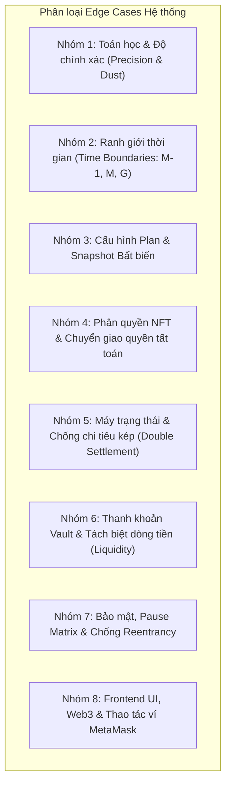

# Kế hoạch Kiểm thử & Bảng Checklist Edge Cases Toàn diện — Online Banking System

## 1. Goal Description (Mục tiêu tổng quát)

Dự án **Online Banking System** là hệ thống tiền gửi có kỳ hạn (Term Deposit) phi tập trung hoạt động trên Ethereum, sử dụng token MockUSDC (6 decimals), phát hành chứng chỉ số quyền sở hữu dưới dạng NFT ERC721 (SDC - Saving Deposit Certificate), và tách biệt nghiêm ngặt hai luồng tiền:
- **Principal (Tiền gốc)** do `SavingCore` lưu ký, quản lý qua sổ nợ `totalPrincipal`.
- **Interest (Tiền lãi)** do ngân hàng quản lý độc lập tại `VaultManager`.

Để đảm bảo hệ thống đạt độ tin cậy tuyệt đối (100% test pass, độ bao phủ >98%, không xảy ra thất thoát quỹ hay kẹt tiền người dùng), tài liệu này cung cấp:
1. **Phân loại toàn diện các kịch bản biên (Edge Cases)** bao gồm: Toán học & Độ chính xác số học (Precision), Ranh giới thời gian (Time Boundary), Bất biến của bản ghi (Snapshot Immutability), Máy trạng thái & Chống chi tiêu kép (Double Settlement), Phân quyền & Chuyển giao chứng chỉ NFT (Ownership & Transferability), Thanh khoản cạn kiệt (Liquidity Shortfall), và Ma trận khẩn cấp (Emergency Pause).
2. **Bảng Checklist chuẩn hóa** cho từng test case, bao gồm mã test ID, điều kiện tiên quyết, hành vi kỳ vọng, custom error / event tương ứng, và cách thức kiểm chứng (Automated command / Manual UI step).
3. **Kế hoạch xác minh (Verification Plan)** tự động và thủ công.

---

## 2. User Review Required (Hạng mục Cần Người dùng Xác nhận)

> [!IMPORTANT]
> **1. Quy tắc làm tròn số học (Rounding Dust Policy):**
> Lãi suất và phí phạt sử dụng phép toán `Math.mulDiv` với quy tắc **làm tròn xuống (Integer Floor)** tới đơn vị token nhỏ nhất ($10^{-6}$ MockUSDC). Toàn bộ phần lãi dư phân số (fractional dust) được giữ lại trong VaultManager (có lợi cho ngân hàng) và không bao giờ gây ra sai lệch số dư.
>
> **2. Cơ chế xử lý khi Vault thiếu thanh khoản (Empty Vault Behavior):**
> Khi Vault không đủ token để chi trả lãi tại thời điểm đáo hạn (`withdrawAtMaturity`), toàn bộ giao dịch sẽ **revert nguyên tử (`InsufficientVaultBalance`)**, tiền gốc của người dùng được bảo toàn tại SavingCore nhưng chưa thể rút được cho đến khi Bank Admin nạp thêm quỹ vào Vault.
>
> **3. Quyền sở hữu chứng chỉ NFT chuyển nhượng (Transferable Certificate):**
> Quyền tất toán tài chính gắn liền với `ownerOf(depositId)` hiện tại. Nếu Alice chuyển NFT cho Bob qua `transferFrom`, Bob có toàn quyền rút tiền; Alice và Approved Operator bị chặn ngay lập tức. Sau khi rút, NFT vẫn được giữ lại làm chứng chỉ lịch sử (không bị burn) nhưng không thể rút lần thứ hai.
>
> **4. Tính bất biến của Deposit Terms (Immutable Snapshot):**
> Admin cập nhật APR, bật/tắt Plan, hoặc đổi Fee Receiver **hoàn toàn không làm thay đổi các snapshot** (`aprBpsAtOpen`, `penaltyBpsAtOpen`, `startAt`, `maturityAt`) của các deposit đang Active. API cũ `setDepositTimeline` đã bị loại bỏ hoàn toàn on-chain.

---

## 3. Open Questions (Câu hỏi Làm rõ)

> [!NOTE]
> Bạn có muốn bổ sung thêm các kịch bản kiểm thử tải đồng thời (stress-testing / concurrent race-conditions) trên Testnet Sepolia hay tập trung tối đa vào môi trường Local mô phỏng (Hardhat network + Playwright E2E) để kiểm thử ranh giới từng giây?

---

## 4. Phân loại Edge Cases & Bảng Checklist Chi tiết

Hệ thống edge case được tổ chức thành **8 nhóm trọng yếu** bao quát từ Smart Contract đến Frontend và Web3 provider:



---

### Nhóm 1: Toán học & Độ chính xác số học (Financial Precision & Dust)

Công thức chuẩn:
$$\text{Interest} = \left\lfloor \frac{P \times \text{aprBps} \times (M - S)}{365 \times 86,400 \times 10,000} \right\rfloor$$
$$\text{Penalty} = \left\lfloor \frac{P \times \text{penaltyBps}}{10,000} \right\rfloor$$

| Test ID | Kịch bản Edge Case | Điều kiện đầu vào | Hành vi & Bất biến kỳ vọng | Mã lỗi / Event / Kết quả | Cách verify |
|---|---|---|---|---|---|
| **PREC-001** | Tiền gửi cực tiểu $1$ đơn vị ($10^{-6}$ USDC) | $P = 1$, Plan 1 (180d, 200 bps) | Lãi floor về $0$; Vault không bị gọi `payInterest(0)`; rút đáo hạn nhận đúng $1$ unit gốc | `Withdrawn(id, alice, 1, 0, false)` | `npm.cmd test -- --grep "PREC-001"` |
| **PREC-002** | Tiền gửi nhỏ tạo lãi phân số $< 1$ unit | $P = 100$ units ($0.0001$ USDC) | Lãi floor về $0$; không underflow; Vault balance không đổi | `calculateInterest(id) == 0` | `npm.cmd test -- --grep "PREC-002"` |
| **PREC-003** | Phần dư lẻ phân số (Fractional dust) | $P = 1,000$ USDC ($10^9$ units), 180d, 200 bps | Lãi lý thuyết $9,863,013.698...$ units; Hợp đồng trả đúng $9,863,013$; phần dư $0.698...$ ở lại Vault | Vault giảm đúng $9,863,013$; user nhận $1,009,863,013$ | `npm.cmd test -- --grep "PREC-003"` |
| **PREC-004** | Số tiền lẻ có 6 số thập phân | $P = 123.456789$ USDC ($123,456,789$ units) | Tính lãi floor chính xác tới từng unit; không lệch 1 wei | `calculateInterest` $= 1,217,656$ units | `npm.cmd test -- --grep "PREC-004"` |
| **PREC-005** | APR biên tối thiểu ($0\text{ bps} = 0\%$) | $\text{aprBps} = 0$, $P = 1,000$ USDC | Lãi $= 0$; rút đáo hạn nhận đúng $P$; Vault không giảm | `Withdrawn(..., P, 0, false)` | `npm.cmd test -- --grep "PREC-005"` |
| **PREC-006** | APR biên tối đa ($10,000\text{ bps} = 100\%$) | $\text{aprBps} = 10000$, Tenor = 365d | Lãi đúng bằng $P$; tổng payout $= 2P$ | User nhận $2P$; Vault giảm $P$ | `npm.cmd test -- --grep "PREC-006"` |
| **PREC-007** | Kỳ hạn siêu ngắn (Plan 5 giây) | Tenor = 5s, $P = 1,000$ USDC, 200 bps | Sinh chính xác $3$ units ($0.000003$ USDC); frontend hiển thị 6 số lẻ | `calculateInterest` $= 3$ units | `npm.cmd test -- --grep "DUR-007"` |
| **PREC-008** | Phép nhân trung gian cực lớn (Tránh tràn số) | $P = 10^{10}$ USDC ($10^{16}$ units), APR $10,000$, 365d | `Math.mulDiv` tính an toàn không tràn số `uint256` | Lãi $= 10^{16}$ units | `npm.cmd test -- --grep "PREC-012"` |
| **PEN-001** | Phạt rút trước hạn biên tối thiểu ($0\text{ bps}$) | $\text{penaltyBps} = 0$ | User nhận đủ $100\%$ gốc; `feeReceiver` nhận $0$ | `Withdrawn(..., P, 0, true)` | `npm.cmd test -- --grep "PEN-001"` |
| **PEN-002** | Phạt rút trước hạn biên tối đa ($10,000\text{ bps} = 100\%$) | $\text{penaltyBps} = 10000$ | User nhận $0$; `feeReceiver` nhận toàn bộ $100\%$ gốc | `token.balanceOf(feeReceiver) += P` | `npm.cmd test -- --grep "PEN-004"` |
| **PEN-003** | Phạt rút trước hạn lẻ phân số | $P = 1,234,567$ units, penalty $350\text{ bps}$ | Phạt $F = 43,209$, net $1,191,358$; bảo toàn $F + \text{net} = P$ | Tổng trả ra bằng đúng gốc | `npm.cmd test -- --grep "PEN-006"` |
| **COMP-001** | Tái tục tự động lũy kế 3 chu kỳ liên tiếp | Chu kỳ 1: $1,000$ USDC; mỗi chu kỳ cộng dồn $P' = P + I$ | Mỗi chu kỳ áp dụng làm tròn floor riêng; không sai số gộp | $P_2 = 1,009,863,013$, $P_3 = 1,019,823,305$ | `npm.cmd test -- --grep "COMP-001"` |

---

### Nhóm 2: Ranh giới Thời gian (Exact Time Boundaries)

Ranh giới xác định: $M = \text{maturityAt}$, $G = M + \text{gracePeriodSeconds}$.

| Test ID | Mốc thời gian | Thao tác thực hiện | Kết quả kỳ vọng | Mã lỗi / Trạng thái | Cách verify |
|---|---|---|---|---|---|
| **TIME-001** | Đúng $t = M - 1\text{s}$ | Gọi `withdrawAtMaturity(id)` | **REVERT**: Chưa tới thời điểm đáo hạn | `DepositNotMatured(id, maturityAt)` | `npm.cmd test -- --grep "TIME-001"` |
| **TIME-002** | Đúng $t = M - 1\text{s}$ | Gọi `earlyWithdraw(id)` | **SUCCESS**: Vẫn được phép rút trước hạn | Payout $P - \text{penalty}$ | `npm.cmd test -- --grep "TIME-001"` |
| **TIME-003** | Đúng $t = M$ (Exact Maturity) | Gọi `earlyWithdraw(id)` | **REVERT**: Đã hết thời hạn rút sớm | `EarlyWithdrawalClosed(id, maturityAt)` | `npm.cmd test -- --grep "TIME-002"` |
| **TIME-004** | Đúng $t = M$ (Exact Maturity) | Gọi `withdrawAtMaturity(id)` | **SUCCESS**: Được tất toán đáo hạn ngay tại giây $M$ | Payout $P + I$ | `npm.cmd test -- --grep "TIME-002"` |
| **TIME-005** | Đúng $t = M$ (Exact Maturity) | Gọi `renewDeposit(id, newPlan)` | **SUCCESS**: Được phép tái tục thủ công | Đúc successor NFT mới | `npm.cmd test -- --grep "BND-R02"` |
| **TIME-006** | Đúng $t = M$ | Gọi `autoRenewDeposit(id)` | **REVERT**: Đang trong Grace Period | `GracePeriodNotEnded(id, graceEnd)` | `npm.cmd test -- --grep "BND-R03"` |
| **TIME-007** | Đúng $t = G - 1\text{s}$ | Gọi `autoRenewDeposit(id)` | **REVERT**: Chưa hết Grace Period ($172,800\text{s}$) | `GracePeriodNotEnded(id, graceEnd)` | `npm.cmd test -- --grep "BND-R05"` |
| **TIME-008** | Đúng $t = G$ (Exact Grace End) | Gọi `autoRenewDeposit(id)` | **SUCCESS**: Được phép kích hoạt auto-renew tại đúng $G$ | Đúc successor NFT cho Owner | `npm.cmd test -- --grep "BND-R06"` |
| **TIME-009** | Tại $t > G$ (Ví dụ $t = G + 30\text{ ngày}$) | Gọi `withdrawAtMaturity(id)` hoặc `renewDeposit` | **SUCCESS**: Nếu bot chưa chạy, User vẫn giữ toàn quyền thao tác | Tất toán bình thường | `npm.cmd test -- --grep "BND-R08"` |
| **TIME-010** | Trễ hạn (Dead bot - trễ 1 tháng) | Bất kỳ ai gọi `autoRenewDeposit(id)` sau 1 tháng | Chỉ nhận lãi kỳ cũ, $S_{\text{new}} = t_{\text{exec}}$, không tính lãi thời gian trễ | $M_{\text{new}} = t_{\text{exec}} + \text{tenor}$ | `npm.cmd test -- --grep "INT-A03"` |

---

### Nhóm 3: Cấu hình Plan & Snapshot Bất biến (Plan Validation & Snapshot Immutability)

| Test ID | Kịch bản Edge Case | Điều kiện đầu vào | Hành vi & Bất biến kỳ vọng | Mã lỗi / Event / Kết quả | Cách verify |
|---|---|---|---|---|---|
| **PLAN-001** | Tạo plan có Tenor $= 0$ ngày hoặc $0$ giây | `tenorDays = 0` hoặc `tenorSeconds = 0` | **REVERT**: Tenor phải nguyên dương | `InvalidTenor(0)` hoặc `InvalidTenorSeconds(0)` | `npm.cmd test -- --grep "INP-BND-001"` |
| **PLAN-002** | Tạo plan vượt quá `uint32.max` ngày | `tenorDays > type(uint32).max` | **REVERT**: Tràn giới hạn | `InvalidTenor` | `npm.cmd test -- --grep "INP-BND-003"` |
| **PLAN-003** | APR vượt quá $10,000\text{ bps}$ ($> 100\%$) | `aprBps = 10001` | **REVERT**: APR ngoài phạm vi | `InvalidApr(10001)` | `npm.cmd test -- --grep "INP-BND-004"` |
| **PLAN-004** | Penalty vượt quá $10,000\text{ bps}$ ($> 100\%$) | `penaltyBps = 10001` | **REVERT**: Phí phạt ngoài phạm vi | `InvalidPenalty(10001)` | `npm.cmd test -- --grep "INP-BND-005"` |
| **PLAN-005** | Giới hạn tiền gửi nghịch đảo ($min > max$) | `minDeposit = 500`, `maxDeposit = 100` | **REVERT**: Min không được lớn hơn Max | `InvalidDepositLimits(500, 100)` | `npm.cmd test -- --grep "INP-BND-006"` |
| **PLAN-006** | Gói có $min == max$ | `minDeposit = 1000`, `maxDeposit = 1000` | **SUCCESS**: Cho phép tạo gói số tiền cố định | Gửi đúng $1,000$ thì pass | `npm.cmd test -- --grep "INP-BND-007"` |
| **PLAN-007** | Gói không giới hạn hạn mức | `minDeposit = 0`, `maxDeposit = 0` | **SUCCESS**: Chấp nhận mọi số tiền $> 0$ | Gửi $1$ unit hay $1M$ đều pass | `npm.cmd test -- --grep "INP-BND-008"` |
| **PLAN-008** | Mở deposit với số tiền $= 0$ | `amount = 0` | **REVERT**: Số tiền phải lớn hơn 0 | `AmountZero()` | `npm.cmd test -- --grep "INP-BND-010"` |
| **PLAN-009** | Mở deposit vi phạm cận min/max | `amount = min - 1` hoặc `amount = max + 1` | **REVERT**: Số tiền ngoài phạm vi | `DepositAmountOutOfRange` | `npm.cmd test -- --grep "INP-BND-010"` |
| **PLAN-010** | Mở deposit trên Plan đang bị disable | Plan 3 có `enabled = false` | **REVERT**: Gói đã đóng | `PlanDisabled(3)` | `npm.cmd test -- --grep "INP-BND-011"` |
| **PLAN-011** | Non-admin can thiệp cấu hình Plan | User gọi `createPlan`, `updatePlan`, `disablePlan` | **REVERT**: Không có quyền Admin | `NotBankAdmin(caller)` | `npm.cmd test -- --grep "INP-BND-013"` |
| **IMM-001** | Bất biến APR khi Admin sửa gói | Mở deposit APR 200 bps $\to$ Admin update plan lên 500 bps | Deposit cũ giữ nguyên 200 bps; chỉ deposit mới nhận 500 bps | `deposit.aprBpsAtOpen == 200` | `npm.cmd test -- --grep "IMM-002"` |
| **IMM-002** | Bất biến khi Admin disable gói | Mở deposit $\to$ Admin disable plan | Deposit cũ vẫn rút trước hạn hoặc đáo hạn bình thường | Tất toán thành công | `npm.cmd test -- --grep "IT-008"` |
| **IMM-003** | Xóa bỏ vĩnh viễn API sửa timeline | Bất kỳ ai gửi selector cũ `setDepositTimeline` | **REVERT**: Hàm không tồn tại trong hợp đồng | Revert vô điều kiện | `npm.cmd test -- --grep "IMM-001"` |

---

### Nhóm 4: Phân quyền NFT & Chuyển giao Quyền Tất toán (NFT Ownership & Transferability)

| Test ID | Kịch bản Edge Case | Thao tác thực hiện | Kết quả kỳ vọng | Mã lỗi / Trạng thái | Cách verify |
|---|---|---|---|---|---|
| **OWN-001** | Người gửi ban đầu tất toán sau khi đã bán/chuyển NFT | Alice mở deposit $\to$ transfer NFT cho Bob $\to$ Alice gọi `withdrawAtMaturity` | **REVERT**: Alice không còn là owner của chứng chỉ | `NotDepositOwner(id, alice)` | `npm.cmd test -- --grep "OWN-002"` |
| **OWN-002** | Người nhận NFT mới tất toán tiền | Bob nhận NFT từ Alice $\to$ Bob gọi `withdrawAtMaturity` | **SUCCESS**: Toàn bộ gốc + lãi chuyển về ví Bob | Bob nhận $P+I$; Alice nhận 0 | `npm.cmd test -- --grep "OWN-002"` |
| **OWN-003** | Approved Operator cố gắng trực tiếp rút tiền | Bob approve cho Operator $\to$ Operator gọi `withdrawAtMaturity` | **REVERT**: Chỉ `ownerOf` mới có quyền tài chính | `NotDepositOwner(id, operator)` | `npm.cmd test -- --grep "OWN-005"` |
| **OWN-004** | Bank Admin cố ý chiếm đoạt tiền của User | Admin gọi `withdrawAtMaturity` của Deposit thuộc về Alice | **REVERT**: Quyền Admin không thể ghi đè quyền NFT | `NotDepositOwner(id, admin)` | `npm.cmd test -- --grep "OWN-006"` |
| **OWN-005** | Chuyển nhượng chứng chỉ NFT lịch sử đã tất toán | Alice đã rút tiền $\to$ transfer NFT (Withdrawn) cho Bob $\to$ Bob gọi rút tiếp | **REVERT**: Không thể rút tiền lần hai từ chứng chỉ cũ | `DepositNotActive(id, Withdrawn)` | `npm.cmd test -- --grep "OWN-007"` |
| **OWN-006** | Auto-renew khi NFT đã đổi chủ sở hữu | Alice transfer NFT cho Bob $\to$ Người lạ kích hoạt `autoRenewDeposit` | **SUCCESS**: Successor NFT mới được mint thẳng về ví Bob | `ownerOf(newId) == bob` | `npm.cmd test -- --grep "OWN-008"` |
| **OWN-007** | Chuyển nhượng NFT trong lúc hệ thống bị Emergency Pause | Vault paused $\to$ Alice gọi `transferFrom` sang Bob | **SUCCESS**: Chuyển nhượng ERC721 không bị pause chặn | NFT đổi chủ an toàn | `npm.cmd test -- --grep "PAUSE-011"` |

---

### Nhóm 5: Máy trạng thái & Chống Chi tiêu kép (State Machine & Double Settlement)

Trạng thái: `0: Active`, `1: Withdrawn`, `2: ManualRenewed`, `3: AutoRenewed`.

| Test ID | Giao dịch A (Thành công trước) | Trạng thái sau A | Giao dịch B (Cố ý gọi sau) | Kết quả giao dịch B | Bảo toàn số dư | Cách verify |
|---|---|---|---|---|---|---|
| **DS-001** | `withdrawAtMaturity(1)` | `Withdrawn (1)` | `withdrawAtMaturity(1)` | **REVERT** `DepositNotActive(1, 1)` | Không mất tiền lần 2 | `npm.cmd test -- --grep "DS-001"` |
| **DS-002** | `earlyWithdraw(1)` | `Withdrawn (1)` | `earlyWithdraw(1)` | **REVERT** `DepositNotActive(1, 1)` | Không trả gốc lần 2 | `npm.cmd test -- --grep "DS-002"` |
| **DS-003** | `renewDeposit(1, 2)` | `ManualRenewed (2)` | `renewDeposit(1, 2)` | **REVERT** `DepositNotActive(1, 2)` | Không đúc 2 successor | `npm.cmd test -- --grep "DS-003"` |
| **DS-004** | `autoRenewDeposit(1)` | `AutoRenewed (3)` | `autoRenewDeposit(1)` | **REVERT** `DepositNotActive(1, 3)` | Không đúc 2 successor | `npm.cmd test -- --grep "DS-004"` |
| **DS-005** | `renewDeposit(1, 2)` | `ManualRenewed (2)` | `autoRenewDeposit(1)` | **REVERT** `DepositNotActive(1, 2)` | Chặn đua lệnh Auto | `npm.cmd test -- --grep "DS-005"` |
| **DS-006** | `autoRenewDeposit(1)` | `AutoRenewed (3)` | `renewDeposit(1, 2)` | **REVERT** `DepositNotActive(1, 3)` | Chặn đua lệnh Manual | `npm.cmd test -- --grep "DS-006"` |
| **DS-007** | `withdrawAtMaturity(1)` | `Withdrawn (1)` | `autoRenewDeposit(1)` | **REVERT** `DepositNotActive(1, 1)` | Chặn auto-renew khi đã rút | `npm.cmd test -- --grep "DS-007"` |
| **DS-008** | `autoRenewDeposit(1)` | `AutoRenewed (3)` | `withdrawAtMaturity(1)` | **REVERT** `DepositNotActive(1, 3)` | Chặn rút khi đã auto-renew | `npm.cmd test -- --grep "DS-008"` |
| **DS-009** | `withdrawAtMaturity(1)` | `Withdrawn (1)` | `renewDeposit(1, 2)` | **REVERT** `DepositNotActive(1, 1)` | Chặn renew khi đã rút | `npm.cmd test -- --grep "DS-009"` |
| **DS-010** | `renewDeposit(1, 2)` | `ManualRenewed (2)` | `withdrawAtMaturity(1)` | **REVERT** `DepositNotActive(1, 2)` | Chặn rút khi đã renew | `npm.cmd test -- --grep "DS-010"` |
| **DS-011** | Truy vấn ID $= 0$ hoặc ID chưa mở | Chưa tồn tại | Bất kỳ hàm settlement nào | **REVERT** `DepositNotFound` | ID không tồn tại | `npm.cmd test -- --grep "STATE-SEC-001"` |

---

### Nhóm 6: Thanh khoản Vault & Tách biệt Dòng tiền (Liquidity Shortfall & Accounting)

Bất biến dòng tiền: $\text{MockUSDC.balanceOf}(\text{SavingCore}) \ge \text{totalPrincipal} = \sum_{\text{Active}} P_i$.

| Test ID | Kịch bản Edge Case | Điều kiện thực hiện | Hành vi & Bất biến kỳ vọng | Kết quả / Event | Cách verify |
|---|---|---|---|---|---|
| **LIQ-001** | Vault thiếu đúng $1$ unit lãi khi đáo hạn | Lãi $= 9,863,013$, Vault chỉ còn $9,863,012$ | Toàn bộ giao dịch **revert nguyên tử**; gốc của User tại Core an toàn $100\%$, status vẫn `Active` | `InsufficientVaultBalance` | `npm.cmd test -- --grep "WD-M13"` |
| **LIQ-002** | Khôi phục sau khi nạp bổ sung thanh khoản | Tiếp nối LIQ-001 $\to$ Admin gọi `fundVault(1)` | User retry `withdrawAtMaturity` $\to$ **SUCCESS** | Payout đủ gốc và lãi | `npm.cmd test -- --grep "IT-007"` |
| **LIQ-003** | Rút trước hạn khi Vault cạn sạch tiền | Vault balance $= 0$, User rút trước hạn | **SUCCESS**: Rút trước hạn chỉ lấy tiền từ Core và trả phí về Fee Receiver, hoàn toàn không đụng tới Vault | User nhận $P - F$, feeReceiver nhận $F$ | `npm.cmd test -- --grep "WD-E07"` |
| **LIQ-004** | Nạp tặng token trực tiếp vào SavingCore (Donation) | Kẻ xấu gửi thẳng $10,000$ USDC vào địa chỉ SavingCore | `totalPrincipal` **không tăng**; thặng dư này **không bao giờ** được dùng để thay thế tiền lãi của Vault | Thặng dư bị cô lập | `npm.cmd test -- --grep "ACC-001"` |
| **LIQ-005** | Admin rút thanh khoản dư thừa từ Vault | Admin gọi `withdrawVault` vừa bằng số dư hiện có | Vault về $0$ an toàn; không thể rút vượt quá số dư (`InsufficientVaultBalance`) | `VaultWithdrawn` | `npm.cmd test -- --grep "VAULT-SEC-002"` |
| **LIQ-006** | Phí phạt gửi về `feeReceiver` mới cập nhật | Admin đổi `feeReceiver` từ Carol sang Dave $\to$ rút sớm | Phí phạt chuyển ngay lập tức về Dave; tỷ lệ phạt giữ nguyên snapshot cũ | `token.balanceOf(dave) += penalty` | `npm.cmd test -- --grep "FeeReceiverUpdated"` |

---

### Nhóm 7: Bảo mật, Pause Matrix & Chống Reentrancy

| Test ID | Kịch bản Edge Case | Thao tác thực hiện | Kết quả kỳ vọng | Mã lỗi / Event | Cách verify |
|---|---|---|---|---|---|
| **PAUSE-001** | Emergency Pause chặn 5 luồng tài chính của Core | Vault paused $\to$ gọi `openDeposit`, `withdrawAtMaturity`, `earlyWithdraw`, `renewDeposit`, `autoRenewDeposit` | **CẢ 5 HÀM ĐỀU REVERT**: Không để thất thoát quỹ khi khẩn cấp | `EnforcedPause()` | `npm.cmd test -- --grep "PAUSE-001"` |
| **PAUSE-002** | Emergency Pause chặn luồng chi của Vault | Vault paused $\to$ Admin gọi `withdrawVault`, Core gọi `payInterest` | **REVERT**: Khóa mọi dòng tiền ra khỏi Vault | `EnforcedPause()` | `npm.cmd test -- --grep "PAUSE-006"` |
| **PAUSE-003** | Thao tác được phép khi Paused | Vault paused $\to$ Admin `fundVault`, `createPlan`, User `transferFrom`, view getters | **SUCCESS**: Cho phép cứu trợ, cấu hình và xem dữ liệu | Thao tác hoàn tất bình thường | `npm.cmd test -- --grep "PAUSE-008"` |
| **PAUSE-004** | Khôi phục sau Unpause | Admin gọi `unpause` | Toàn bộ chức năng tài chính mở lại bình thường mà không sai sót số dư | Unpause thành công | `npm.cmd test -- --grep "PAUSE-014"` |
| **REENT-001** | Tấn công Reentrancy qua receiver callback trong `openDeposit` | Smart contract mở deposit $\to$ trong `onERC721Received` gọi lại `openDeposit` | **REVERT**: Chặn đứng bởi `nonReentrant` | `ReentrancyGuardReentrantCall` | `npm.cmd test -- --grep "REENT-001"` |
| **REENT-002** | Tấn công Reentrancy gọi `withdrawAtMaturity` | Trong callback `onERC721Received` cố rút tiền lần nữa | **REVERT**: Chặn tái nhập tài chính | `ReentrancyGuardReentrantCall` | `npm.cmd test -- --grep "REENT-004"` |
| **REENT-003** | Tấn công Reentrancy trong quá trình Renewal | Trong callback tái tục cố gọi tái tục lồng nhau | **REVERT**: Chặn tái nhập | `ReentrancyGuardReentrantCall` | `npm.cmd test -- --grep "REENT-002"` |
| **SAFE-001** | Token trả về `false` trong `transferFrom` | Sử dụng token giả lập trả về `false` | SafeERC20 phát hiện và revert toàn bộ giao dịch | `SafeERC20FailedOperation` | `npm.cmd test -- --grep "FAIL-INJ-003"` |
| **SAFE-002** | Người nhận từ chối nhận chứng chỉ ERC721 | Hợp đồng người nhận trả sai selector hoặc revert | Toàn bộ giao dịch mở deposit rollback nguyên tử | `ReceiverRejected` / `ERC721InvalidReceiver` | `npm.cmd test -- --grep "FAIL-INJ-004"` |
| **AUTH-001** | Chặn Admin từ bỏ quyền sở hữu Vault | Admin gọi `renounceOwnership()` | **REVERT**: Luôn yêu cầu có Bank Admin chịu trách nhiệm | `OwnershipRenounceDisabled()` | `npm.cmd test -- --grep "VAULT-SEC-015"` |
| **AUTH-002** | Gán SavingCore vào Vault lần thứ hai | Admin cố bind lại Core mới | **REVERT**: Write-once binding duy nhất 1 lần | `SavingCoreAlreadySet` | `npm.cmd test -- --grep "VAULT-SEC-008"` |

---

### Nhóm 8: Frontend UI, Web3 & Thao tác Ví MetaMask

| Test ID | Kịch bản Edge Case | Thao tác trên giao diện UI | Kết quả kiểm chứng trên giao diện | Cách verify |
|---|---|---|---|---|
| **UI-001** | Quy trình 2 bước: Approve $\to$ Open Deposit | Người dùng nhập số tiền chưa cấp phép | Nút hiển thị `Step 1/2: Approve MockUSDC`; sau khi ký đổi thành `Step 2/2: Open Deposit` | Browser E2E `U01` |
| **UI-002** | Tái sử dụng Allowance (Không bắt approve lại) | Approve $2,000$, mở deposit $1,000$, mở tiếp deposit thứ hai $1,000$ | Lần mở thứ hai bỏ qua bước Approve, vào thẳng nút `Open Deposit` | Browser E2E `U01` |
| **UI-003** | Từ chối giao dịch trên ví (User Rejected - Code 4001) | Người dùng bấm Reject trên popup MetaMask | Hiển thị thông báo tiếng Việt/Anh thân thiện: *"Transaction was cancelled in your wallet."*, không văng crash đỏ | Vitest `errors.test.ts` |
| **UI-004** | Hiển thị số tiền kỳ hạn siêu ngắn (5 giây) | Tạo plan 5s, mở deposit $1,000$ USDC | Lãi hiển thị đầy đủ 6 chữ số thập phân (`0.000003 USDC`), payout `1,000.000003 USDC`, không làm tròn thành $0.00$ | Browser E2E `S01` |
| **UI-005** | Lọc Portfolio theo `ownerOf` thay vì người tạo | Alice gửi NFT cho Bob | Portfolio Alice biến mất thẻ deposit đó; Portfolio Bob lập tức xuất hiện thẻ deposit kèm nút thao tác | Browser E2E `U06` |
| **UI-006** | Phân quyền Admin Portal | Tài khoản EOA thông thường bấm vào tab Admin Portal | Giao diện chặn truy cập và hiển thị cảnh báo `Restricted Access` | Browser E2E `U06` |
| **UI-007** | Tái tục thủ công chọn gói không hợp lệ | Chọn gói đã bị Disable hoặc gốc mới $P+I$ vượt ngoài min/max | Nút chọn gói bị disable hoặc form báo lỗi `DepositAmountOutOfRange` | Browser E2E `U04` |
| **UI-008** | Lịch sử chứng chỉ cũ (Certificate History) | Deposit đã được rút hoặc tái tục | Thẻ deposit chuyển sang tab History với nhãn `Withdrawn`, `ManualRenewed (From #1 -> #2)` | Browser E2E `U02`, `U04` |
| **UI-009** | Mất kết nối RPC node hoặc sai Network | Node local 8545 bị dừng | Banner cảnh báo kết nối hiển thị rõ ràng, hướng dẫn kiểm tra mạng blockchain | Vitest `errors.test.ts` |

---

## 5. Verification Plan (Kế hoạch Xác minh Thực tế)

Để bạn có thể kiểm chứng độc lập từng test case hoặc toàn bộ hệ thống, hãy thực hiện theo quy trình kiểm thử chuẩn hóa dưới đây.

### 5.1. Chạy Tự động qua Bộ Test Suites (Automated Tests)

Mở PowerShell tại thư mục gốc của dự án (`d:\AppsCycloneIntern\OnlineBankingSystem`):

#### Bước 1: Biên dịch & Kiểm tra kiểu dữ liệu tĩnh (Compile & Typecheck)
```powershell
# Biên dịch hợp đồng thông minh
npm.cmd run compile

# Typecheck toàn bộ TypeScript (Root, Frontend, E2E)
npm.cmd run typecheck
npm.cmd --prefix frontend run typecheck
npm.cmd run typecheck:e2e
```

#### Bước 2: Chạy kiểm thử Hợp đồng Thông minh (Smart Contract Regression - 535 tests)
```powershell
# Chạy toàn bộ test suites contract trong output root riêng (không đè manifest)
$env:BANKING_ARTIFACT_ROOT = '.e2e/regression'
$env:SKIP_LOAD_ENV = 'true'
npm.cmd test
```

> **Cách chạy riêng từng nhóm testcase theo tên hoặc mã Test ID:**
> ```powershell
> # Chỉ kiểm tra nhóm ranh giới thời gian (TIME-001..003)
> npx.cmd hardhat test test/SavingCoreIntegration.ts --grep "Exact Time Boundary"
>
> # Chỉ kiểm tra nhóm độ chính xác toán học & số dư lẻ (PREC-001..013)
> npx.cmd hardhat test test/SavingCoreEdgeSecurityPrecision.ts --grep "Group 1: Financial Precision"
>
> # Chỉ kiểm tra nhóm chống chi tiêu kép (Double Settlement DS-001..010)
> npx.cmd hardhat test test/SavingCoreHardening.ts --grep "Group 4: Double Spend"
>
> # Chỉ kiểm tra bất biến kỳ hạn ngắn & xóa timeline (DUR-001..010, IMM-001..002)
> npx.cmd hardhat test test/SavingCoreDuration.ts
> ```

#### Bước 3: Chạy kiểm thử Frontend (Vitest - 76 tests)
```powershell
npm.cmd --prefix frontend test
```

#### Bước 4: Chạy kiểm thử Trình duyệt End-to-End (Playwright Browser E2E - 10 kịch bản)
```powershell
npm.cmd run test:e2e
```

---

### 5.2. Hướng dẫn Kiểm chứng Thủ công trên Trình duyệt (Manual UI Verification)

Để tự mình trải nghiệm và verify các edge cases trên giao diện trực quan:

#### Bước 1: Khởi động môi trường Demo cục bộ
Chạy lệnh duy nhất để khởi động node Hardhat riêng biệt (port 18545), deploy contract, nạp seed data và mở web UI (port 5174):
```powershell
npm.cmd run demo:local
```
Truy cập trình duyệt tại: **http://127.0.0.1:5174**

#### Bước 2: Cấu hình Ví MetaMask
- **RPC URL**: `http://127.0.0.1:18545`
- **Chain ID**: `31337`
- **Import các tài khoản demo (theo Hardhat Private Keys mẫu)**:
  - **Admin**: `0xac0974bec39a17e36ba4a6b4d238ff944bacb478cbed5efcae784d7bf4f2ff80` (Account #0 / Deployer hoặc Account #1 `0x59c6995e998f97a5a0044966f0945389dc9e86dae88c7a8412f4603b6b78690d`)
  - **Alice (User)**: `0x5de4111afa1a4b93908669880f0eed7d9383b252a5a1f64f9dd300b59b471027` (Account #2)
  - **Bob (User)**: `0x7c852118294e51e653712a81e05800f419141751be58f605c371e15141b007a6` (Account #3)

#### Bước 3: Thực hiện xác minh các kịch bản Edge Case trọng tâm
1. **Verify Plan 5 giây & Làm tròn 6 số thập phân (UI-004, PREC-007):**
   - Đăng nhập ví Admin $\to$ Admin Portal $\to$ Chọn `+ New saving plan` $\to$ Đơn vị: `seconds`, Giá trị: `5`, APR: `2.00%`, Penalty: `3.50%` $\to$ Create.
   - Chuyển sang ví Alice $\to$ Chọn Plan 5s vừa tạo $\to$ Nhập 1,000 USDC $\to$ Approve $\to$ Open Deposit.
   - Kiểm tra UI: lãi hiển thị đúng `0.000003 USDC`. Chờ 5 giây $\to$ Bấm Refresh Portfolio $\to$ Nút `Withdraw at Maturity` sáng lên $\to$ Bấm rút $\to$ Nhận đủ `1,000.000003 USDC`.
2. **Verify Emergency Pause (PAUSE-001, UI-006):**
   - Đăng nhập ví Admin $\to$ Bấm `Emergency pause`.
   - Chuyển sang ví Alice $\to$ Cố gắng bấm rút hoặc mở deposit mới $\to$ Modal báo lỗi hệ thống đang bị Pause bởi Admin.
   - Quay lại ví Admin $\to$ Bấm `Unpause system` $\to$ Alice thực hiện lại giao dịch thành công.
3. **Verify Chuyển nhượng NFT cập nhật quyền rút tiền (OWN-001, OWN-002, UI-005):**
   - Alice mở 1 khoản gửi $\to$ Dùng MetaMask gửi NFT token ID tương ứng sang địa chỉ Bob.
   - Bấm Refresh Portfolio ở cả 2 ví: Alice không còn thấy khoản gửi; Bob thấy khoản gửi xuất hiện và có toàn quyền bấm Rút tiền / Tái tục.
4. **Verify Chống chi tiêu kép (DS-001):**
   - Sau khi rút thành công một khoản gửi, vào tab `Certificate History` $\to$ Thẻ deposit hiển thị trạng thái `Withdrawn` và không còn bất kỳ nút thao tác tài chính nào.
